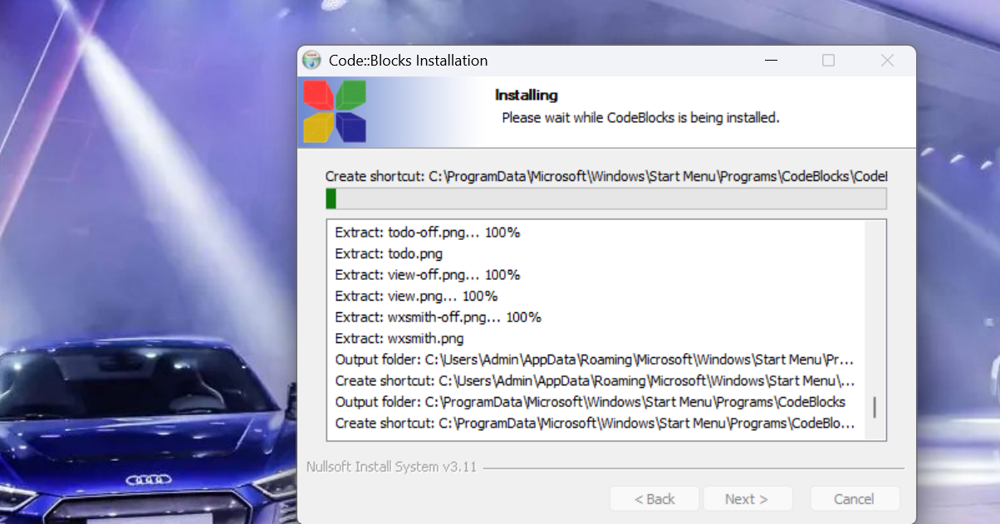
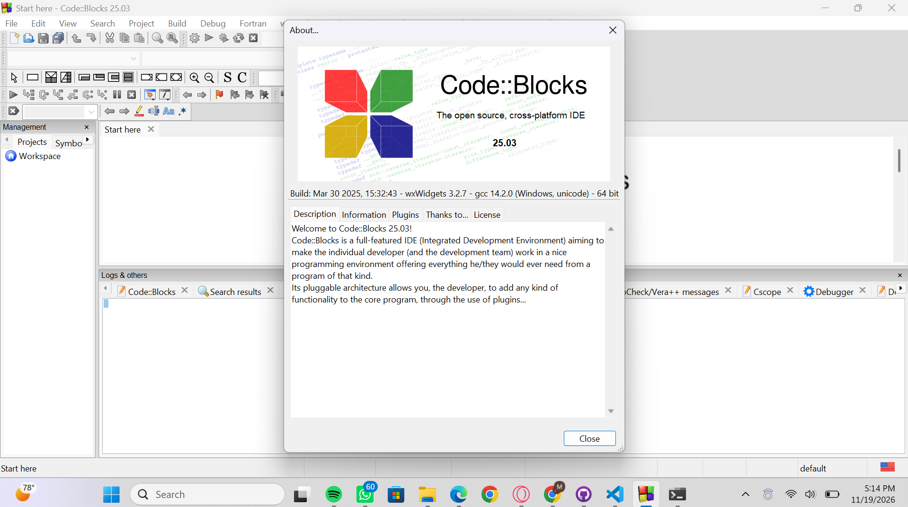
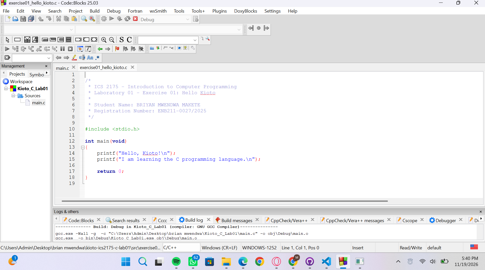
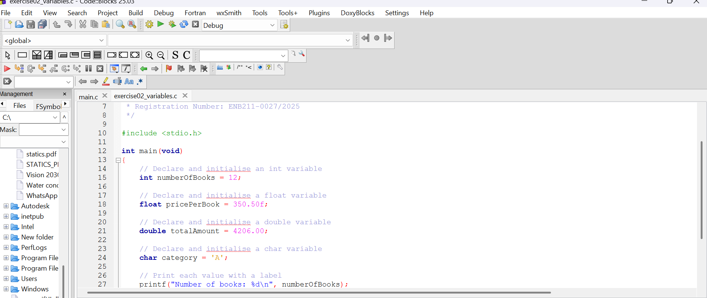
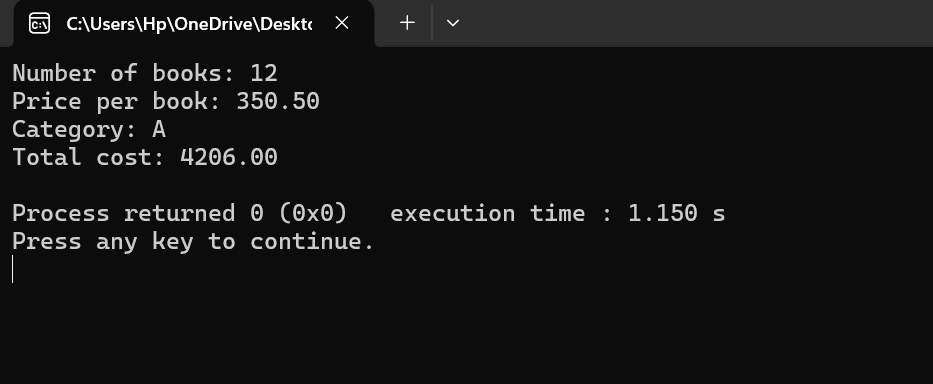
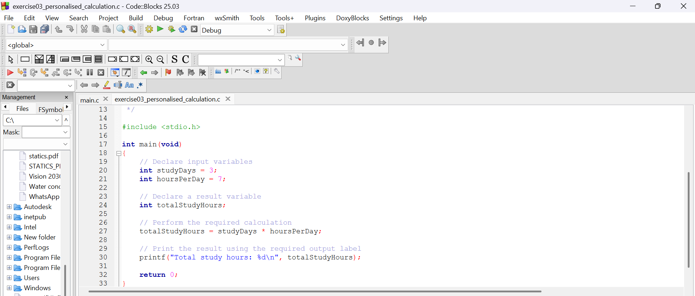
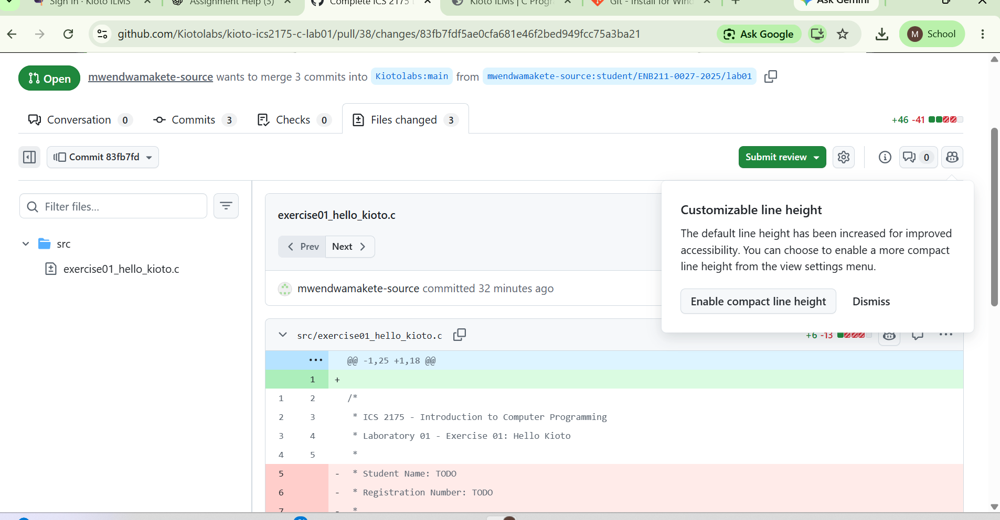
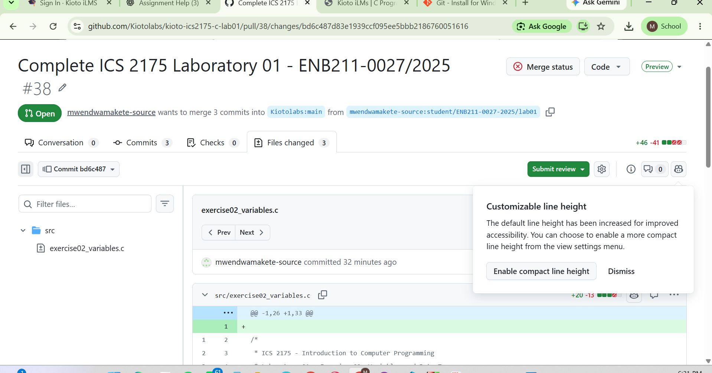
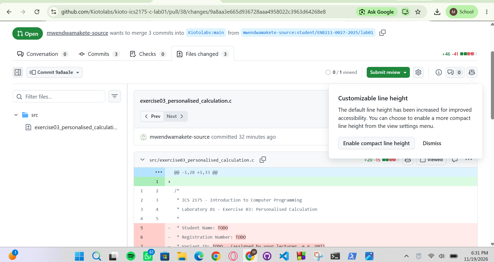

# ICS 2175 – Laboratory 01 Report

## 1. Cover Information

- **Student Full Name:** BRIYAN MWENDWA MAKETE
- **Registration Number:** ENB211-0027/2025
- **Programme:** C
- **GitHub Username:** mwendwamakete-source
- **Assigned Scenario:** Study hours
- **Variant ID:** V19
- **Date:** 19 November 2026

## 2. Objectives

The main objectives of this laboratory were:

1. To install and configure Code::Blocks and the GCC compiler for C programming.
2. To understand the basic structure of a C program, including header files, the `main()` function, statements, and return values.
3. To write, compile, and execute a simple C program that displays messages on the screen.
4. To learn how to declare and use variables of different data types, such as `int`, `float`, `double`, and `char`.
5. To understand how format specifiers are used when displaying variable values.
6. To perform a personalised calculation using the assigned scenario and input values.
7. To identify and correct common programming and compilation errors.
8. To practise using GitHub by forking a repository, creating a branch, making commits, and submitting a pull request.


## 3. Software and Hardware Environment

The laboratory was carried out using the following software and hardware environment:

- **Operating System:** Windows 11
- **IDE:** Code::Blocks
- **Compiler:** GCC 14.2.0 (MinGW-w64)
- **Compiler Location:** `C:\Program Files\CodeBlocks\MinGW\bin\gcc.exe`
- **Hardware:** Windows laptop with approximately 8 GB of RAM.
- **Programming Language:** C (C11 standard)

The GCC compiler was used to compile and test the programs with the following compiler options: `-std=c11 -Wall -Wextra -pedantic`. These options helped identify compilation errors and warnings.


## 4. Code::Blocks Installation and Configuration

I installed Code::Blocks on my Windows 11 computer to provide an environment for writing, compiling and running C programs.

After installation, I configured the GNU GCC compiler that comes with the MinGW installation. The compiler was located in:

`C:\Program Files\CodeBlocks\MinGW`

I confirmed that GCC was installed and working by checking its version. The installed compiler was GCC 14.2.0.

I then created a C Console Application project in Code::Blocks and tested the environment by compiling and running a simple Hello World program. The program executed successfully, confirming that the IDE and compiler were working correctly.

**Evidence:** The Code::Blocks installation, compiler configuration and project setup screenshots are included in Section 11.

## 5. Hello Kioto Implementation

In this exercise, I created a simple C program to display a greeting message on the screen. The program introduced me to the use of the `printf()` function to display text.

The program used the `stdio.h` header file, which provides the standard input and output functions.

### Source Code

```c
#include <stdio.h>

int main(void)
{
    printf("Hello, Kioto!\n");
    printf("I am learning the C programming language.\n");

    return 0;
}
```

### Program Output

```text
Hello, Kioto!
I am learning the C programming language.
```

The program compiled and executed successfully without errors or warnings. I also experimented with removing a semicolon and the newline character (`\n`). Removing the semicolon caused a compilation error, while removing `\n` affected how the output was displayed. I restored both to their correct forms.

This exercise helped me understand how C statements are written and how output is displayed using `printf()`.


## 6. Explanation of C Program Structure

A C program follows a specific structure that allows the compiler to understand and execute instructions.

The main parts of my Hello Kioto program are explained below:

1. **Header file (`#include <stdio.h>`):** This statement includes the standard input and output library. It allows the program to use functions such as `printf()` to display messages.

2. **Main function (`int main(void)`):** This is the main entry point of a C program. Program execution begins inside this function.

3. **Opening and closing braces (`{ }`):** Braces mark the beginning and end of the function body. They group the statements that belong to the function.

4. **Statements (`printf()`):** Statements are instructions executed by the program. In my program, `printf()` displays messages on the screen. Each statement ends with a semicolon (`;`).

5. **Return statement (`return 0;`):** This statement ends the main function and returns zero to the operating system to indicate that the program completed successfully.

Understanding these components helped me learn how a basic C program is organised and executed.

## 7. Variables and Data Types

In this exercise, I created a C program to demonstrate the use of variables and different data types. The program stored information about books and calculated their total cost.

The variables used were:

| Variable | Data type | Purpose |
|---|---|---|
| `numberOfBooks` | `int` | Stores the number of books (12). |
| `pricePerBook` | `float` | Stores the price of one book (350.50). |
| `totalAmount` | `double` | Stores the total cost of all the books (4206.00). |
| `category` | `char` | Stores the book category ('A'). |

The program used the following format specifiers in the `printf()` function:

- `%d` displays an integer value.
- `%.2f` displays a floating-point value to two decimal places.
- `%.2f` also displays a `double` value to two decimal places when used with `printf()`.
- `%c` displays a single character.

### Program Output

```text
Number of books: 12
Price per book: 350.50
Total amount: 4206.00
Category: A
```

The program demonstrated how different data types are declared and used in C. It also showed how variables can be used in arithmetic calculations.

## 8. Personalised Calculation

For this exercise, I used the personalised scenario assigned to my registration number, ENB211-0027/2025.

My assigned variant was **V19**, with the scenario **Study hours**.

The program used the following input values:

- Number of study days: 3
- Hours studied per day: 7
- Operation: Multiplication

The program multiplied the number of study days by the hours studied per day to calculate the total study hours.

### Source Code

```c
#include <stdio.h>

int main(void)
{
    int studyDays = 3;
    int hoursPerDay = 7;
    int totalStudyHours;

    totalStudyHours = studyDays * hoursPerDay;

    printf("Total study hours: %d\n", totalStudyHours);

    return 0;
}
```

### Calculation

Total study hours = 3 × 7 = 21 hours.

### Program Output

```text
Total study hours: 21
```

The program compiled and executed successfully. This exercise helped me understand how to use variables and arithmetic operators to solve a practical problem using C programming.


## 9. Testing and Troubleshooting

I tested all three C programs to confirm that they compiled and executed correctly.

I used the GCC compiler with the following command options:

`-std=c11 -Wall -Wextra -pedantic`

These options enabled the C11 standard and helped identify programming errors and warnings.

### Testing Results

| Exercise | Test performed | Result |
|---|---|---|
| Exercise 01 | Displayed the Hello Kioto greeting. | Successful |
| Exercise 02 | Calculated the total cost of 12 books. | Successful |
| Exercise 03 | Calculated total study hours using 3 × 7. | Successful |

### Challenges and Solutions

During the laboratory, I encountered a few challenges:

1. **GCC not recognised:** Initially, the terminal did not recognise the `gcc` command. I solved this by using the full path to the GCC executable inside the Code::Blocks MinGW folder.

2. **Incorrect folder path:** I initially entered an incorrect project folder path in PowerShell. I corrected the folder name and navigated to the right project directory.

3. **Compilation errors:** I experimented with removing a semicolon from a `printf()` statement. This caused a compilation error. I restored the semicolon and compiled the program again.

4. **Running the wrong program:** At one point, Code::Blocks displayed output from a different program. I solved this by compiling and running the correct source files individually using PowerShell.

After correcting these issues, all three programs compiled and ran successfully without errors or warnings.

## 10. GitHub Workflow

I used GitHub to manage and submit my laboratory work.

The steps I followed were:

1. **Forking:** I forked the original laboratory repository, `Kiotolabs/kioto-ics2175-c-lab01`, to my GitHub account.

2. **Cloning:** I cloned my forked repository to my local computer using GitHub Desktop.

3. **Branch creation:** I created a separate working branch named `student/ENB211-0027-2025/lab01` to keep my laboratory changes organised.

4. **Editing files:** I created and updated the three C source files in the `src` directory and prepared my laboratory report in the `report` directory.

5. **Committing changes:** I made three meaningful commits to record the progress and changes made to my laboratory work.

6. **Pushing changes:** I pushed my commits to my forked GitHub repository so that the changes were available online.

7. **Pull request:** I used a pull request to propose my changes to the original laboratory repository.

The GitHub workflow helped me understand how developers use forks, branches, commits and pull requests to collaborate and manage source code.

### Pull Request Submission

After pushing my three commits, I successfully created a pull request to the original Kiotolabs repository.

- **Pull Request Number:** #38
- **Pull Request Title:** Complete ICS 2175 Laboratory 01 - ENB211-0027/2025
- **Source Branch:** `student/ENB211-0027-2025/lab01`
- **Target Branch:** `main`
- **Pull Request Status:** Open
- **Pull Request Link:** https://github.com/Kiotolabs/kioto-ics2175-c-lab01/pull/38

The pull request contains three commits and proposes my laboratory changes for review. I left it open without merging it.


## 11. Screenshots

The following screenshots provide evidence of the installation, configuration, implementation, testing and GitHub submission activities completed during this laboratory.

All screenshots are stored in the `report/screenshots/` directory.

### 11.1 Code::Blocks Installation and Configuration

**Figure 1: Code::Blocks installation evidence**



**Figure 2: Code::Blocks version information**



**Figure 3: Code::Blocks project setup**


**Figure 4: Successful program build**


### 11.2 Exercise 01 – Hello Kioto

**Figure 5: Exercise 01 source code**



**Figure 6: Exercise 01 output**


### 11.3 Exercise 02 – Variables and Data Types

**Figure 7: Exercise 02 source code**



**Figure 8: Exercise 02 output**



### 11.4 Exercise 03 – Personalised Calculation

**Figure 9: Exercise 03 source code**



**Figure 10: Exercise 03 output**


### 11.5 GitHub Workflow Evidence

**Figure 11: Forked GitHub repository**


**Figure 12: Student working branch**


**Figure 13: First commit**



**Figure 14: Second commit**



**Figure 15: Third commit**



**Figure 16: Submitted pull request**


## 12. Individual Reflection

This laboratory has helped me develop a better understanding of the C programming language and the basic steps involved in software development.

I learned how to install and configure Code::Blocks and use the GCC compiler to compile and execute C programs. I also gained practical experience using `printf()`, declaring variables, working with different data types and performing arithmetic calculations.

One of the most important lessons was understanding how small mistakes, such as missing semicolons, can cause compilation errors. I learned to read error messages, correct mistakes and test my programs again.

I also gained experience using GitHub. I learned how to fork a repository, clone it, create a working branch, make commits and submit a pull request.

The most challenging part was configuring and using the compiler from the terminal and ensuring that I was running the correct source file. I overcame these challenges by checking file paths and compiling each program individually.

In future programming assignments, I will organise my project files carefully, test my code regularly and make meaningful Git commits as I work instead of waiting until the end.


## 13. Conclusion

In conclusion, ICS 2175 Laboratory 01 provided me with practical experience in getting started with C programming. I successfully installed and configured Code::Blocks and GCC, created and executed three C programs, and learned about program structure, variables, data types and arithmetic operations.

I also completed my personalised study-hours calculation for Variant V19, which produced a result of 21 total study hours.

Furthermore, I gained practical experience using GitHub for version control by forking a repository, creating a branch, making three commits and submitting Pull Request #38 for review.

Overall, this laboratory strengthened my understanding of basic C programming and introduced me to important software development practices.