# ICS 2175 – LABORATORY 01 REPORT

## 1. Cover Information

- **Student Full Name:** CLINTON KIPCHIRCHIR
- **Registration Number:** ENB211-0111/2025
- **Programme:** Agricultural and Biosystems Engineering
- **Programming Language:** C
- **GitHub Username:** clintonyugo-ops
- **Assigned Scenario:** Stationery Order Cost
- **Variant ID:** V03
- **Date:** 23 November 2026

---

## 2. Objectives

The main objective of this laboratory was to introduce the fundamentals of C programming.

The specific objectives were:

1. To understand the basic structure of a C program.
2. To learn how to write, compile and execute C programs using Code::Blocks.
3. To understand variables and different data types in C.
4. To learn how to display information using the `printf()` function.
5. To perform basic mathematical calculations using C programming.
6. To gain practical experience in managing programming projects using GitHub.

---

## 3. Software and Hardware Environment

The laboratory was carried out using a Windows 11 laptop with Code::Blocks as the Integrated Development Environment (IDE).

The following software and hardware were used:

### Software

- **Operating System:** Windows 11
- **IDE:** Code::Blocks
- **Programming Language:** C
- **Compiler:** GNU GCC Compiler (MinGW)

### Hardware

- **Computer:** Laptop
- **RAM:** 8 GB
- **Storage Capacity:** 256 GB

---

## 4. Code::Blocks Installation and Configuration

Code::Blocks was used as the Integrated Development Environment (IDE) for writing, compiling and executing C programs during the laboratory.

### 4.1 Installation

Code::Blocks was installed on a Windows 11 laptop. The version containing the GNU GCC compiler (MinGW) was used to provide the tools required to compile and run C programs.

### 4.2 Configuration

After installation, Code::Blocks was opened and configured to use the GNU GCC compiler. The compiler was checked to ensure that it was properly detected by the IDE.

### 4.3 Creating a C Project

A new C Console Application project was created in Code::Blocks. This provided an environment for writing and testing the laboratory programs.

The source code was written in the editor and saved using the `.c` file extension.

### 4.4 Building and Running the Program

The Build and Run option was used to compile and execute the programs. The compiler checked the source code for errors before execution.

Successful compilation and execution confirmed that the development environment was working correctly.

### 4.5 Evidence

The following screenshots show the installation and configuration process:

**Figure 1: Code::Blocks About dialog.**

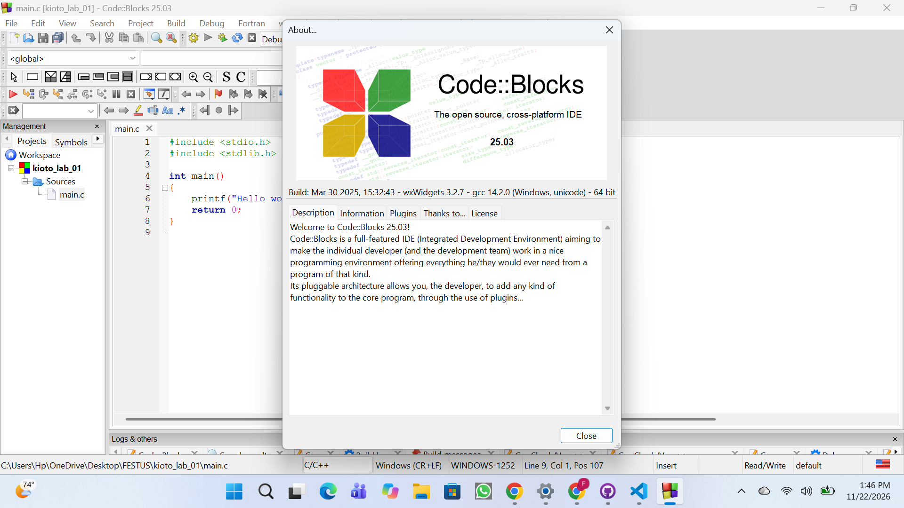

**Figure 2: Project setup in Code::Blocks.**

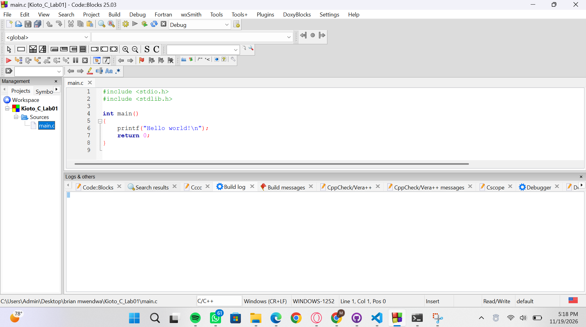

**Figure 3: Successful build log.**

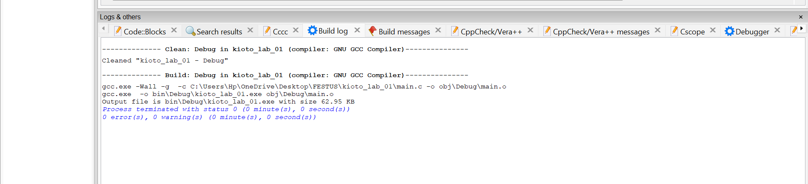

---

## 5. Hello Kioto Implementation

The first exercise involved writing a simple C program to display a greeting message on the computer screen. The program introduced the use of the `stdio.h` header file, the `main()` function and the `printf()` output function.

### 5.1 Program Code

The following C program was written using Code::Blocks:

```c
#include <stdio.h>

int main(void)
{
    printf("Hello, Kioto!\n");
    printf("I am learning the C programming language.\n");

    return 0;
}
```

### 5.2 Explanation of the Program

1. `#include <stdio.h>` includes the standard input and output library.
2. `int main(void)` defines the main function where program execution begins.
3. `printf()` displays messages on the computer screen.
4. `\n` moves the output to a new line.
5. `return 0;` indicates that the program has completed successfully.

### 5.3 Compilation and Execution

The program was compiled using the GNU GCC compiler in Code::Blocks. After successful compilation, it was executed to display the greeting messages.

### 5.4 Program Output

The program produced the following output:

```text
Hello, Kioto!
I am learning the C programming language.

Process returned 0 (0x0)
```

### 5.5 Evidence

**Figure 4: Hello Kioto program source code.**


**Figure 5: Hello Kioto program output.**

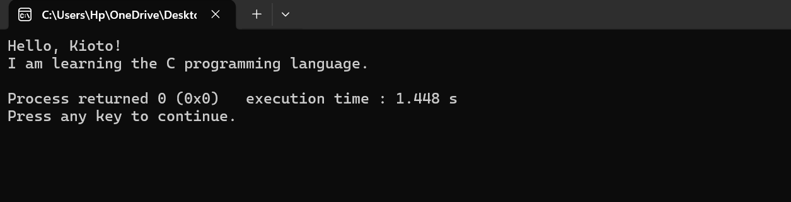

The output confirmed that the program executed successfully and displayed the expected messages without errors.

### 5.6 Conclusion

The exercise introduced me to writing, compiling and executing a basic C program. I also learned how to use the `printf()` function to display messages on the screen.

---

## 6. Explanation of C Program Structure

A C program follows a specific structure that allows the computer to understand and execute instructions. Exercise 2 demonstrated the basic structure of a C program.

The main components of the program are explained below:

### 6.1 Header File

`#include <stdio.h>`

This statement includes the standard input and output library. It allows the program to use functions such as `printf()` to display information on the screen.

### 6.2 Main Function

`int main(void)`

The main function is where the execution of a C program begins. Every standard C program requires a main function.

### 6.3 Curly Braces

`{ }`

Curly braces indicate the beginning and end of the main function. They contain the instructions that the program executes.

### 6.4 Variable Declaration

Variables are used to store data in a program. In Exercise 2, the following variables were declared:

- `int numberOfBooks = 12;`
- `float pricePerBook = 350.50f;`
- `char category = 'A';`

### 6.5 Statements

Statements are instructions given to the computer to perform specific tasks. Most C statements end with a semicolon.

### 6.6 Output Function

The `printf()` function is used to display the values of variables and other information on the computer screen.

### 6.7 Return Statement

`return 0;`

This statement indicates that the program has completed execution successfully.

### 6.8 Conclusion

Understanding the structure of a C program makes it easier to write, compile, debug and execute computer programs.

---

## 7. Variables and Data Types

Variables are used to store data in a C program. Different data types are used depending on the kind of information being stored.

In Exercise 2, I used three different data types: integer, float and character.

### 7.1 Integer Data Type (int)

The integer data type is used to store whole numbers without decimal points.

Example:

`int numberOfBooks = 12;`

This variable stores the number of books, which is 12.

### 7.2 Float Data Type (float)

The float data type is used to store numbers that contain decimal points.

Example:

`float pricePerBook = 350.50f;`

This variable stores the price of one book, which is 350.50.

### 7.3 Character Data Type (char)

The character data type is used to store a single character.

Example:

`char category = 'A';`

This variable stores the category letter A.

### 7.4 Calculation of Total Cost

The program calculates the total cost by multiplying the number of books by the price per book.

**Formula:**

Total Cost = Number of Books × Price per Book

**Calculation:**

Total Cost = 12 × 350.50

Total Cost = 4206.00

The calculation was performed using:

`float totalCost = numberOfBooks * pricePerBook;`

### 7.5 Format Specifiers

Format specifiers are used with the `printf()` function to display different data types.

- `%d` – Used to display integer values.
- `%f` – Used to display floating-point values.
- `%.2f` – Displays a decimal number to two decimal places.
- `%c` – Used to display a single character.

### 7.6 Program Output

```text
Number of books: 12
Price per book: 350.50
Category: A
Total cost: 4206.00
```

### 7.7 Conclusion

Exercise 2 helped me understand how to declare and initialise variables, use different data types, perform calculations and display results using the `printf()` function.

---

## 8. Personalised Calculation

In Exercise 3, I was assigned Variant V03, which involved calculating the total cost of a stationery order.

### 8.1 Assigned Scenario

The scenario involved finding the total cost of items purchased by multiplying the price per item by the quantity purchased.

**Variant ID:** V03

**Scenario:** Stationery Order Cost

### 8.2 Given Values

- Price per item = 40
- Quantity = 4
- Category = A

### 8.3 Formula

Total Cost = Price per Item × Quantity

### 8.4 Calculation

Total Cost = 40 × 4

Total Cost = 160

Therefore, the total cost of the stationery order is 160.

### 8.5 Program Output

```text
Price per item: 40
Quantity: 4
Category: A
Total cost: 160
```

The program executed successfully and displayed the correct result. The message `Process returned 0 (0x0)` confirmed that the program completed successfully.

### 8.6 Conclusion

This exercise helped me understand how to use variables and arithmetic operators in C programming. I also learned how to multiply values and display the calculated result using the `printf()` function.

---

## 9. Testing and Troubleshooting

The programs were tested using the Code::Blocks Integrated Development Environment (IDE).

### 9.1 Compilation

Each C program was compiled using the GNU GCC compiler. Compilation was done to check whether the source code contained errors.

### 9.2 Execution and Testing

After successful compilation, each program was executed to check whether it produced the expected output.

The following tests were performed:

1. **Exercise 1:** Tested the Hello Kioto program to confirm that the greeting messages appeared correctly.
2. **Exercise 2:** Tested the variables and data types program to confirm that the number of books, price per book, category and total cost were displayed correctly.
3. **Exercise 3:** Tested the personalised calculation program to confirm that multiplying 40 by 4 produced 160.

### 9.3 Troubleshooting

During the laboratory, the programs were checked for correct syntax, variable declarations and output statements.

The programs executed successfully. The console message `Process returned 0 (0x0)` indicated successful execution.

### 9.4 Testing Results

All three exercises were executed and produced the expected results.

The testing process improved my understanding of compiling, running and checking C programs.

---

## 10. GitHub Workflow

GitHub was used for version control and management of the laboratory project. It helped to store the source code, track changes and submit the completed work.

### 10.1 Forking the Repository

The original laboratory repository was forked from the lecturer's GitHub repository into my personal GitHub account.

### 10.2 Cloning the Repository

The forked repository was cloned to my local computer to allow me to work on the project using Code::Blocks.

### 10.3 Creating a Feature Branch

A separate feature branch was created to organise the laboratory work.

**Branch name:**

`student/ENB211-0111/2025/lab01`

### 10.4 Committing Changes

The project changes were saved using Git commits. Sixteen commits were made to show the progress of the work.

### 10.5 Pushing Changes

The feature branch was pushed to my GitHub repository so that the changes could be accessed online.

### 10.6 Creating a Pull Request

A pull request was created from my fork to the original laboratory repository. This allowed the lecturer to review the submitted work.

### 10.7 GitHub Details

- **GitHub Username:** clintonyugo-ops
- **Repository Link:** https://github.com/clintonyugo-ops/kioto-ics2175-c-lab01
- **Feature Branch:** student/ENB211-0111/2025/lab01
- **Pull Request Link:** https://github.com/Kiotolabs/kioto-ics2175-c-lab01/pull/50
- **Pull Request Number:** #50

### 10.8 Conclusion

The GitHub workflow helped me understand repository management, branching, committing changes and submitting programming work for review.

---

## 11. Screenshots

The following screenshots provide evidence of the laboratory activities and successful completion of the exercises.

### 11.1 Project Setup


### 11.2 Code::Blocks Configuration


### 11.3 Exercise 1 – Hello Kioto


### 11.4 Exercise 2 – Variables and Data Types


### 11.5 Exercise 3 – Personalised Calculation

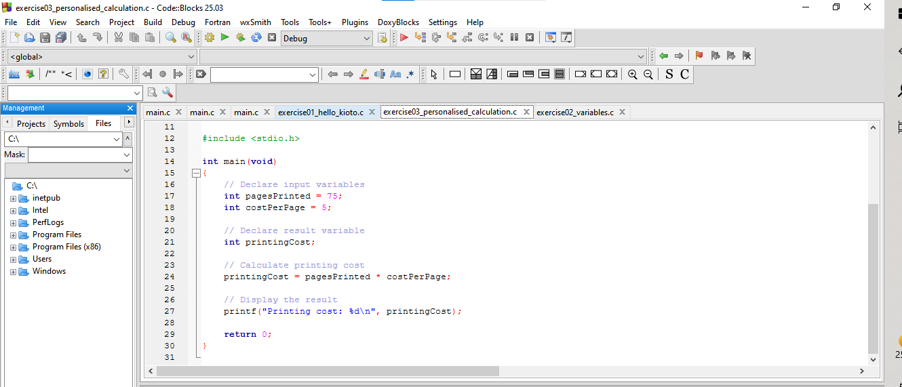

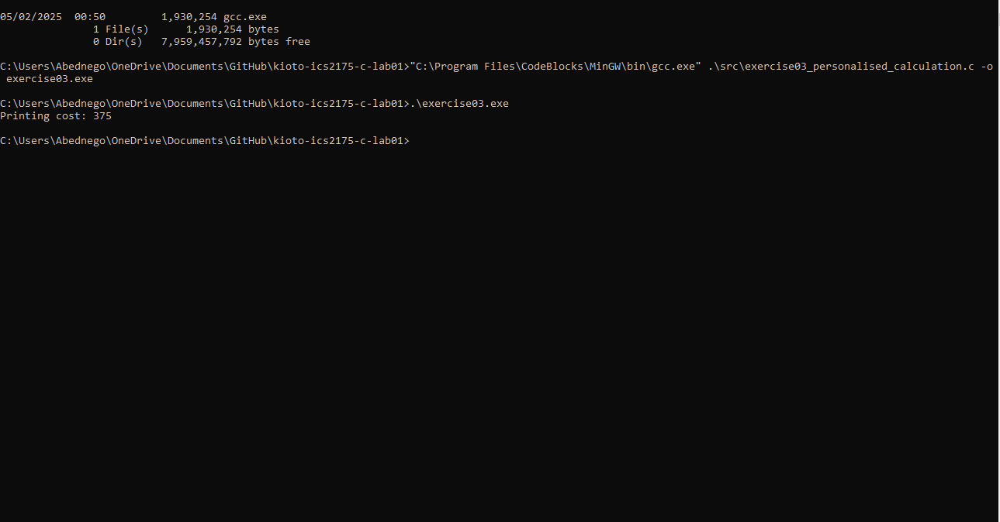

### 11.6 GitHub Workflow


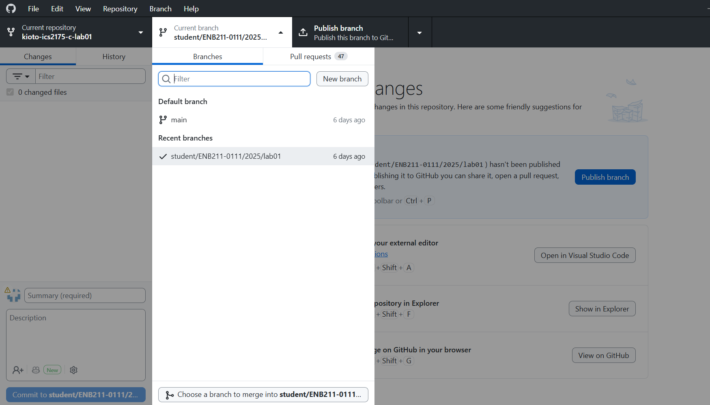

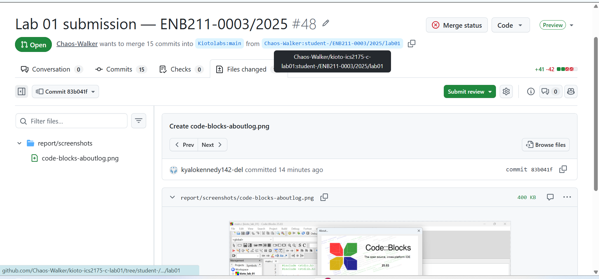

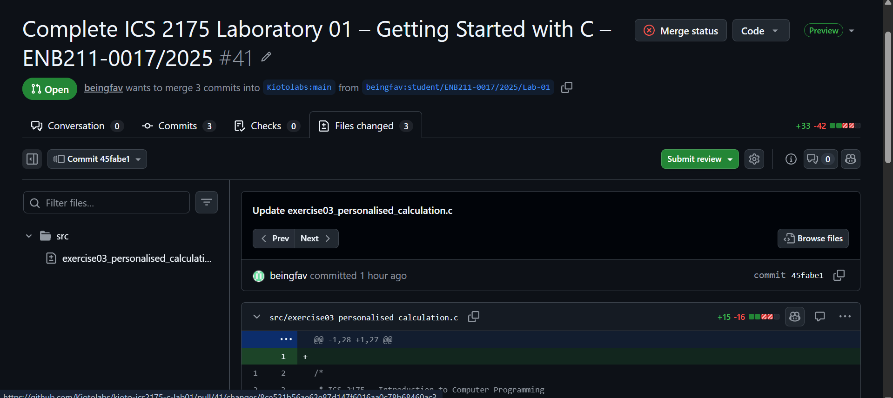

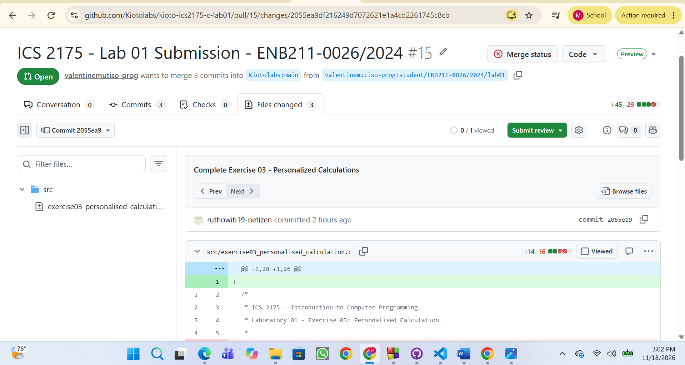

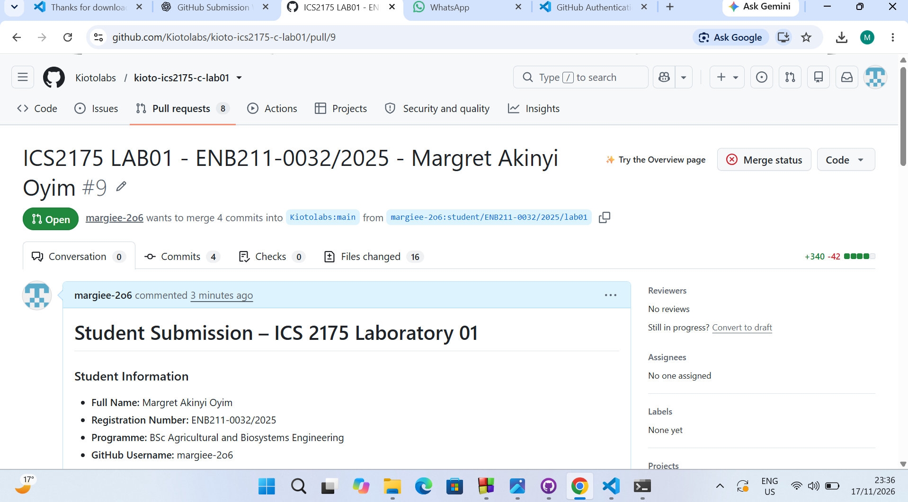

### 11.7 Successful Build


---

## 12. Individual Reflection

The laboratory provided practical experience in learning the fundamentals of C programming.

### 12.1 What I Learned

Through this laboratory, I learned how to:

1. Write and execute basic C programs using Code::Blocks.
2. Understand the structure of a C program.
3. Declare and initialise variables.
4. Use different data types such as int, float and char.
5. Display information using the `printf()` function.
6. Perform mathematical calculations using arithmetic operators.
7. Use GitHub to manage and submit programming projects.

### 12.2 Challenges Experienced

One of the challenges was understanding the correct structure and syntax of a C program. I also needed to understand how different data types and format specifiers work.

### 12.3 Skills Gained

The laboratory improved my problem-solving skills and introduced me to practical programming. I also gained experience in compiling, testing and managing source code.

### 12.4 Improvements for Future Work

In future programming exercises, I will practise writing more C programs, pay attention to syntax and test my code regularly to identify and correct errors.

---

## 13. Conclusion

The ICS 2175 Laboratory 01 provided practical knowledge of the fundamentals of C programming. I learned how to write, compile and execute C programs using Code::Blocks and the GNU GCC compiler.

The exercises helped me understand program structure, variables, data types, output functions and basic arithmetic calculations. I also gained experience using GitHub for version control, managing project changes and submitting my work through a pull request.

Overall, the laboratory improved my programming knowledge and provided a foundation for learning more advanced programming concepts.