# ICS 2175 – Laboratory 01 Report

## Getting Started with C Programming

## 1. Cover Information

- **Student Full Name:** Margret Akinyi Oyim
- **Registration Number:** ENB211-0032/2025
- **Programme:** BSc Agricultural and Biosystems Engineering
- **GitHub Username:** margiee-2o6
- **Assigned Scenario:** Calculation of the total number of workstations in two computer laboratory rooms.
- **Variant ID:** ENB211-0032/2025
- **Date:** 17 November 2026

## 2. Objectives

The main objectives of this laboratory were:

1. To learn how to write, compile and run simple C programs.
2. To understand the basic structure of a C program.
3. To learn how to declare and initialise variables.
4. To understand the use of different data types in C programming.
5. To perform a simple mathematical calculation using a C program.
6. To gain practical experience using Code::Blocks and the GCC compiler.
7. To learn how to use GitHub and GitHub Desktop to manage and submit programming work.

## 3. Software and Hardware Environment

The following software and hardware were used during the laboratory:

**Software**

- Operating System: Microsoft Windows.
- IDE: Code::Blocks.
- Compiler: GCC.
- Code Editor: Visual Studio Code.
- Version Control Tool: GitHub Desktop.
- Online Repository: GitHub.

**Hardware**

- Computer: HP laptop.
- Keyboard and mouse: Used for entering code and navigating the computer.

## 4. Code::Blocks Installation and Configuration

I installed Code::Blocks on my laptop to provide an environment for writing and running C programs.

After installation, I opened Code::Blocks and checked that the application was working. I then created a project and used the IDE to write and test my C programs.

I also configured the GCC compiler so that it could translate the C source code into executable programs.

The installation and configuration process helped me understand how programming software is prepared before writing code.

**Evidence:** Code::Blocks installation/About screenshot and project screenshot.

## 5. Hello Kioto Implementation

In Exercise 1, I created my first C program. The main purpose was to display a greeting message and introduce my programme of study.

I used the `stdio.h` library because it provides input and output functions such as `printf()`.

The program was:

```c
#include <stdio.h>

int main(void)
{
    printf("Hello, Kioto!\n");
    printf("I am studying Agricultural and Biosystems Engineering.\n");

    return 0;
}
```

The first `printf()` displays the greeting message. The second `printf()` displays my programme of study. The `\n` moves the cursor to a new line.

**Output:**

```text
Hello, Kioto!
I am studying Agricultural and Biosystems Engineering.
```

The program executed successfully and displayed the expected messages.

**Evidence:** Exercise 1 console screenshot.

## 6. Explanation of C Program Structure

A C program has different parts that work together to make the program execute correctly.

**1. The `#include` statement**

The statement `#include <stdio.h>` adds the standard input and output library to the program. It allows the use of functions such as `printf()`.

**2. The `main()` function**

The `main()` function is where the execution of a C program begins. Every basic C program needs a main function.

**3. Statements**

Statements are instructions given to the computer. For example, `printf()` instructs the computer to display information on the screen.

**4. Braces `{ }`**

Braces show the beginning and end of a function or a block of code. The statements inside the braces belong to that block.

**5. The `return 0;` statement**

This indicates that the program has completed successfully.

Understanding these parts helped me know how to arrange instructions when writing a C program.

## 7. Variables and Data Types

In Exercise 2, I declared and initialised four variables using different data types.

The variables used were:

| Variable | Data type | Value |
|---|---|---:|
| `numberOfStudents` | int | 45 |
| `temperature` | float | 26.5 |
| `distance` | double | 12.75 |
| `grade` | char | A |

**Explanation of the data types**

- **int:** Used to store whole numbers, for example 45.
- **float:** Used to store decimal numbers, for example 26.5.
- **double:** Used to store decimal numbers with greater precision.
- **char:** Used to store a single character, for example A.

**Format specifiers**

Format specifiers tell the `printf()` function the type of value to display.

| Data type | Format specifier |
|---|---|
| int | `%d` |
| float | `%f` |
| double | `%f` or `%lf` |
| char | `%c` |

I used meaningful variable names to make the program easier to understand.

The exercise helped me understand how different types of information can be stored and displayed in C programming.

**Evidence:** Exercise 2 console screenshot.

## 8. Personalised Calculation

In Exercise 3, I completed a personalised calculation involving the total number of workstations in two computer laboratory rooms.

**Assigned scenario**

- Room A has 84 workstations.
- Room B has 22 workstations.

**Input values**

- Room A = 84
- Room B = 22

**Arithmetic operation**

Addition was used to calculate the total number of workstations.

**Calculation**

Total workstations = Room A + Room B

Total workstations = 84 + 22

Total workstations = **106**

I used integer variables to store the number of workstations in each room. I then added the two values and stored the answer in another variable called `totalWorkstations`.

The program displayed the values and the final result using the `printf()` function.

**Output label:** Total workstations

**Final result:** 106 workstations.

**Variant ID:** ENB211-0032/2025

**Evidence:** Exercise 3 console screenshot.

## 9. Testing and Troubleshooting

After writing the programs, I compiled and ran them to check whether they worked correctly.

I used Code::Blocks to build and execute the programs. I checked the console output to confirm that the results were displayed as expected.

The laboratory instructions recommended the following GCC compilation command:

```bash
gcc -std=c11 -Wall -Wextra -pedantic
```

This command enables standard C11 compilation and additional warnings that help identify possible problems in the code.

During the laboratory, I also gained experience navigating the programming environment and correcting problems when working with the software.

Testing was important because it helped me confirm that the programs produced the expected outputs.

**Evidence:** Successful build screenshot and screenshots of the three program outputs.

## 10. GitHub Workflow

I used GitHub and GitHub Desktop to manage my laboratory files and prepare my work for submission.

The steps I followed were:

1. I opened the official laboratory repository on GitHub.
2. I forked the repository into my own GitHub account.
3. I installed and opened GitHub Desktop.
4. I cloned my fork to my laptop.
5. I created an individual feature branch for my work.
6. I opened the project in Visual Studio Code.
7. I edited the three C source files in the `src/` folder and completed the report.
8. I made commits to record the changes.
9. I pushed my changes to my GitHub repository.
10. I created a pull request to submit my work to the original laboratory repository for review.

**GitHub username:** `margiee-2o6`

**Forked repository:**

https://github.com/margiee-2o6/kioto-ics2175-c-lab01

**Feature branch:**

`student/ENB211-0032/2025/lab01`

**Commit history:**

The following four commits were made for this laboratory:

1. `Complete Hello Kioto exercise` — `53f8b85`
2. `Implement variables and data types` — `61a6c87`
3. `Complete personalised calculation` — `652a671`
4. `Complete laboratory report and screenshot references` — `748b220`

**Pull Request Details**

- **Pull Request Title:** `ICS2175 LAB01 - ENB211-0032/2025 - Margret Akinyi Oyim`
- **Pull Request Number:** #9
- **Status:** Open (submitted for review; not merged)
- **Pull Request Link:** https://github.com/Kiotolabs/kioto-ics2175-c-lab01/pull/9

The GitHub workflow helped me understand how programmers save changes, track their work and share code using an online repository. Creating the pull request also allowed me to submit my work for review.

**Evidence:** Screenshots of my GitHub fork, feature branch, commit history and pull request.

## 11. Screenshots

The following screenshots provide evidence of the activities completed during the laboratory.

### 1. Code::Blocks About

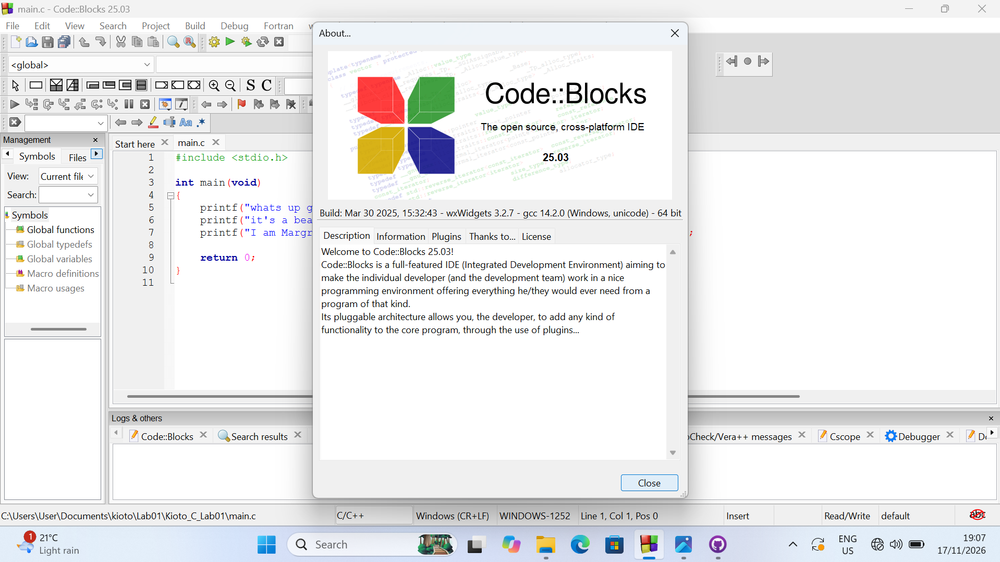

### 2. Code::Blocks Project

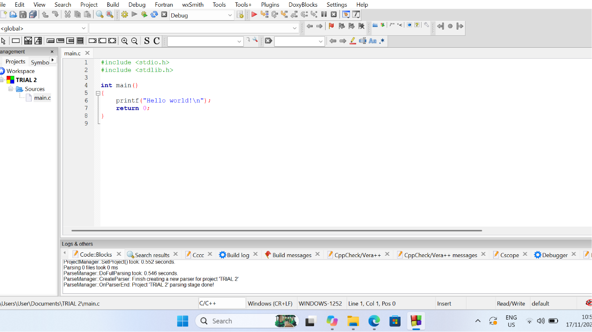

### 3. Successful Build

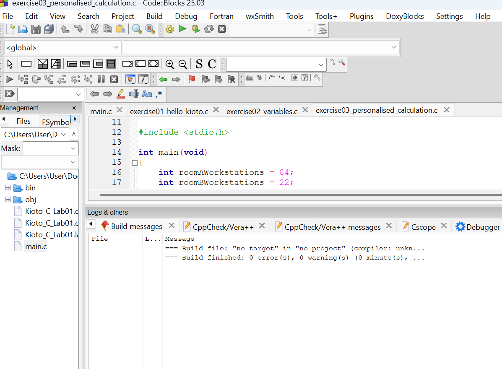

### 4. Exercise 1 Output


### 5. Exercise 2 Output

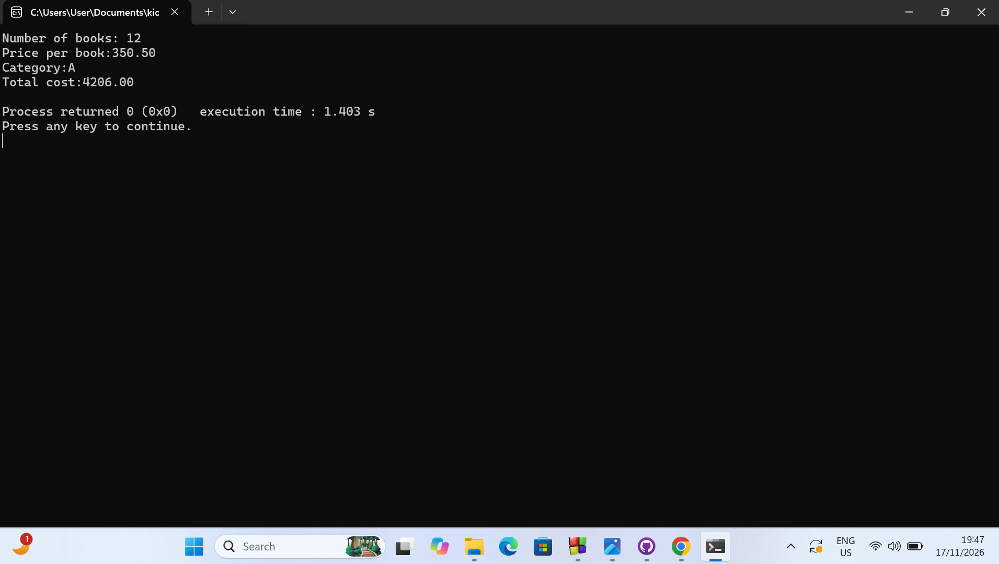

### 6. Exercise 3 Output


### 7. GitHub Fork

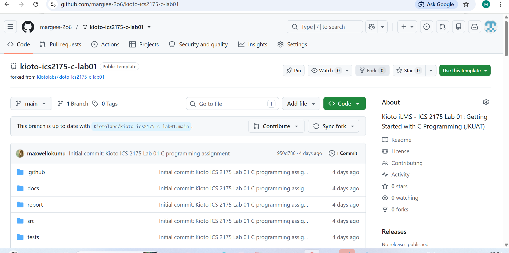

### 8. Feature Branch

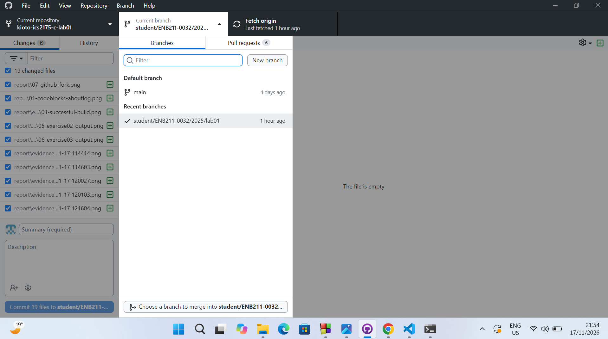

### Additional Source Code Screenshots

**Exercise 1 Source Code**

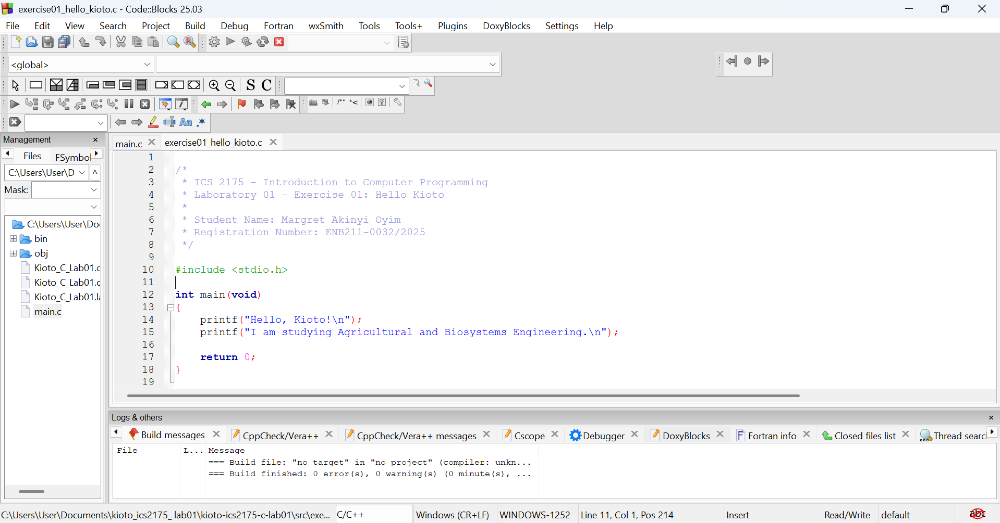

**Exercise 2 Source Code**

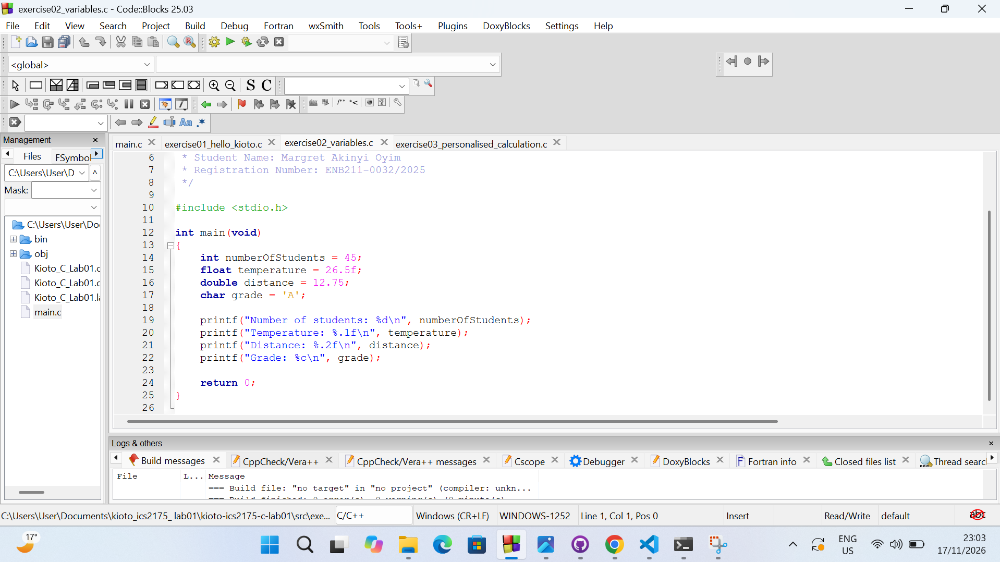

**Exercise 3 Source Code**

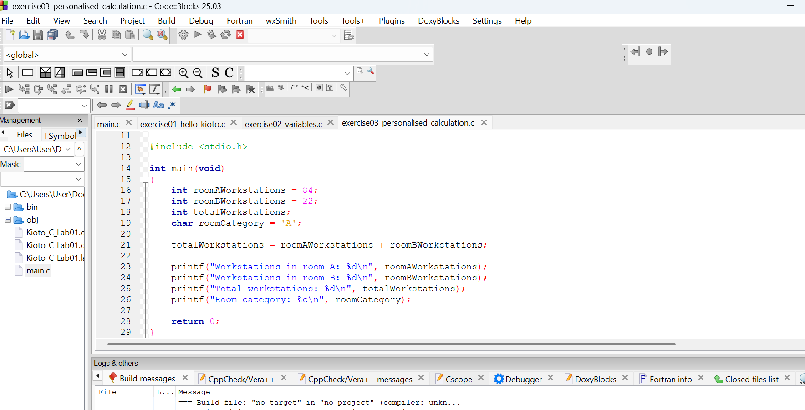

### 9. First Commit

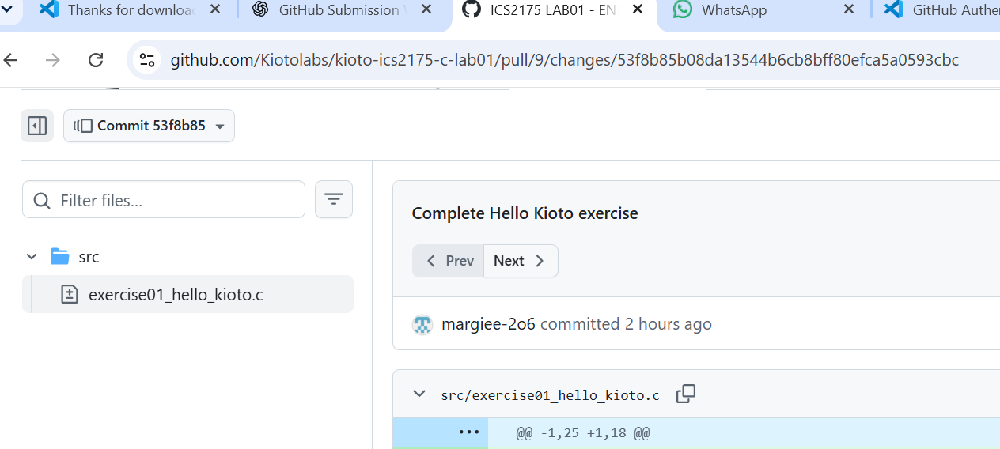

### 10. Second Commit

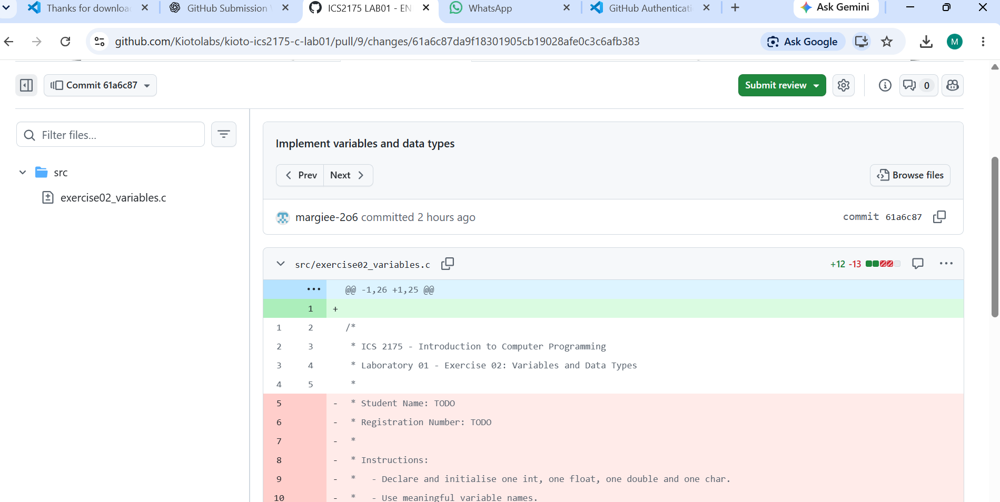

### 11. Third Commit

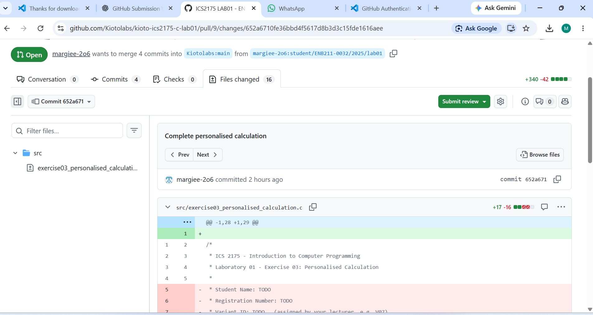

### 12. Pull Request


The screenshots demonstrate the installation, programming, testing and GitHub activities carried out during the laboratory.

## 12. Individual Reflection

This laboratory helped me gain practical knowledge of C programming. I learned how to write simple programs, declare variables, use different data types and perform calculations.

I also learned how to use Code::Blocks and Visual Studio Code when working on programming exercises.

One of the challenges I experienced was becoming familiar with the programming tools and understanding how to manage files using GitHub Desktop. At first, some of the steps were difficult because I was still learning how to use the software.

However, by following the instructions step by step and practising, I became more comfortable with the process.

In future, I will practise writing programs more often, pay attention to compiler messages and try to understand each line of code instead of simply copying it.

## 13. Conclusion

The laboratory introduced me to the basics of C programming. I learned how to write, compile and execute simple C programs.

I successfully worked on the three exercises, including displaying messages, using different data types and performing a personalised calculation.

I also gained experience using Code::Blocks, Visual Studio Code, GitHub and GitHub Desktop.

Overall, the laboratory improved my understanding of programming and provided a foundation for learning more advanced programming concepts.