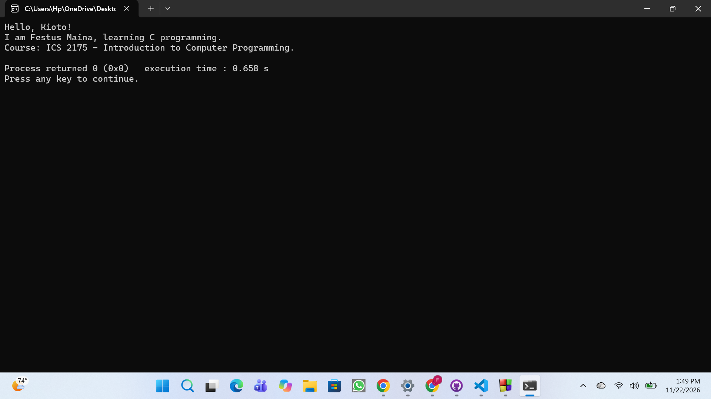
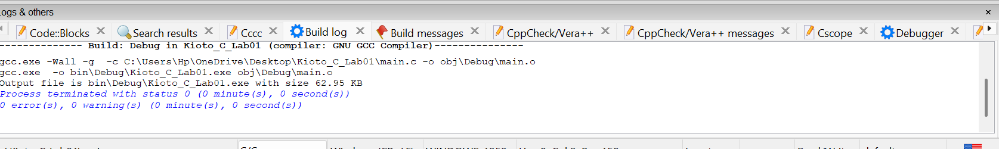
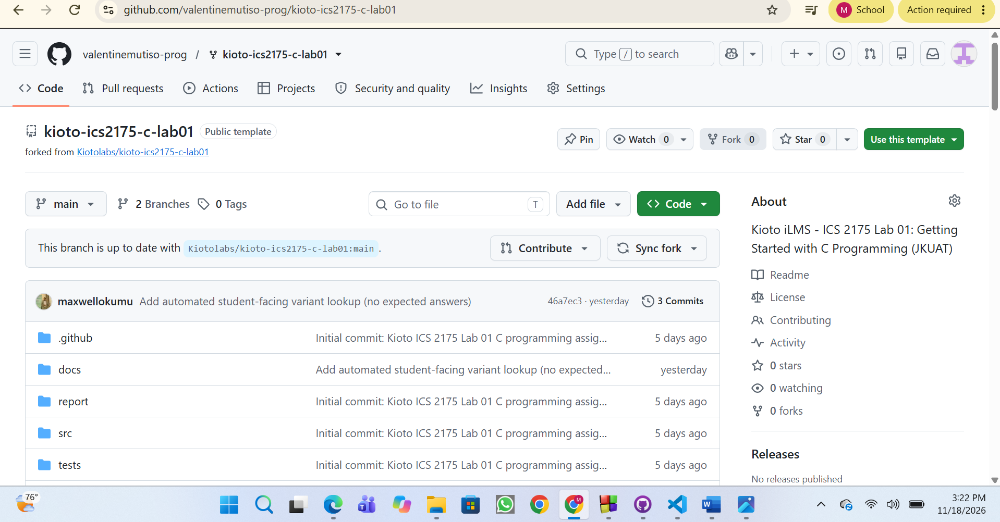
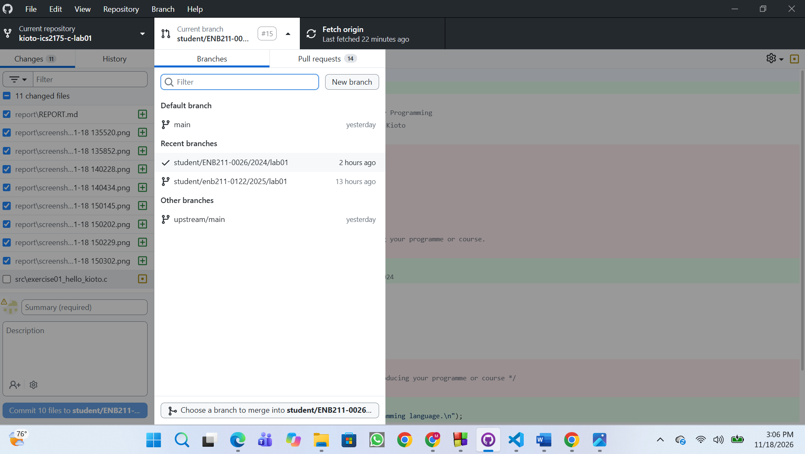
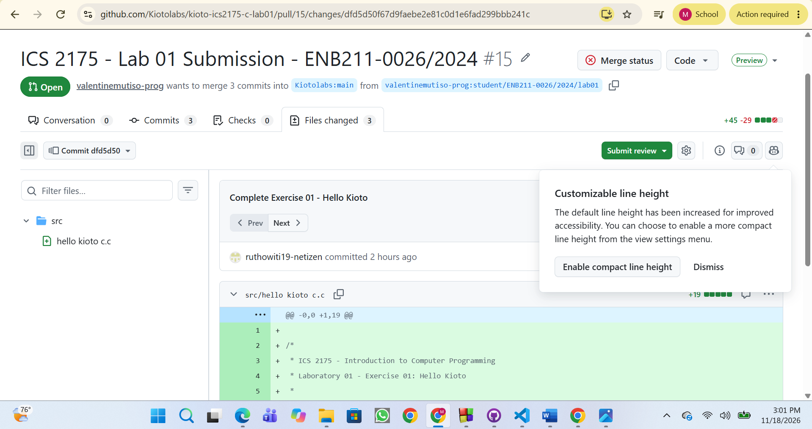
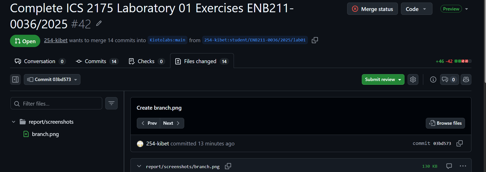
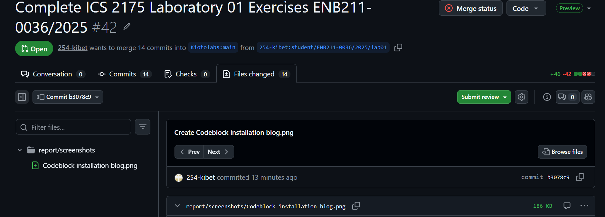

# ICS 2175 – Introduction to Computer Programming

## Laboratory 01: Getting Started with C Programming

**Student Name:** Festus Maina  
**Registration Number:** ENB211-0003/2025  
**Programme:** BSc Agriculture and Biosystems Engineering  
**Unit:** ICS 2175 – Introduction to Computer Programming  
**Laboratory Number:** 01  
**Date of Practical:** 22 November 2026  
**GitHub Username:** Chaos-Walker


## 2. Objectives

The main objective of this laboratory was to gain practical experience in writing, compiling and executing basic C programs using Code::Blocks.

The specific objectives were:

1. To understand the basic structure of a C program, including header files and the `main()` function.
2. To write and execute a simple program that displays text using `printf()`.
3. To declare, initialise and display variables using different C data types.
4. To perform an arithmetic calculation using the inputs assigned in my personalised exercise.
5. To practise testing programs, identifying errors and correcting them.
6. To understand basic GitHub operations, including forking a repository, creating a branch, committing changes and submitting a pull request.


## 3. Software and Hardware Environment

### 3.1 Hardware Environment

The practical was carried out using an HP EliteBook 830 G6 laptop with the following specifications:

- **Computer Model:** HP EliteBook 830 G6
- **Processor:** Intel Core i5-8365U CPU @ 1.60 GHz
- **Processor Cores:** 4 cores and 8 logical processors
- **RAM:** 8 GB
- **Storage Capacity:** 256 GB
- **System Type:** 64-bit operating system, x64-based processor

### 3.2 Software Environment

The following software and tools were used for the laboratory:

- **Operating System:** Microsoft Windows 11 Pro, Version 10.0.26300
- **IDE:** Code::Blocks
- **Compiler:** GNU GCC with MinGW
- **Programming Language:** C
- **Version Control:** Git and GitHub
- **Web Browser:** Used to access GitHub and the university iLMs platform.

Code::Blocks provides the environment for writing and managing C programs, while GCC compiles the source code into executable programs. Git and GitHub support version control and submission of the laboratory work.


## 4. Code::Blocks Installation and Configuration

I installed Code::Blocks on my Windows 11 Pro laptop to provide an environment for developing C programs.

After installation, I opened Code::Blocks and prepared it for C programming. The IDE provides a source code editor, build tools and program execution facilities.

The configuration process involved checking the available GNU GCC compiler and ensuring that Code::Blocks could use the compiler to build C programs.

I used Code::Blocks as the main development environment for the three laboratory exercises.


## 5. Hello Kioto Implementation

### 5.1 Introduction

The first exercise involved creating a simple C program to display a greeting message and introduce myself. I used the `printf()` function to display text in the console.

### 5.2 Source Code

The following is the C program for Exercise 1:

```c
#include <stdio.h>

int main(void)
{
    printf("Hello, Kioto!\n");
    printf("I am Festus Maina, learning C programming.\n");
    printf("Course: ICS 2175 - Introduction to Computer Programming.\n");

    return 0;
}
```

### 5.3 Explanation of the Program

- `#include <stdio.h>`: Includes the standard input/output library, which provides the `printf()` function.
- `int main(void)`: Defines the main function where program execution begins.
- `printf()`: Displays messages on the screen.
- `\n`: Moves the cursor to a new line after displaying a message.
- `return 0;`: Indicates that the program has completed successfully.

### 5.4 Program Output

The expected output is:

```text
Hello, Kioto!
I am Festus Maina, learning C programming.
Course: ICS 2175 - Introduction to Computer Programming.
```

### 5.5 Observation

The exercise demonstrated how a C program displays text using the `printf()` function. It also showed the importance of correct syntax, including semicolons and newline characters.


## 6. Explanation of C Program Structure

A C program follows a specific structure that allows the compiler to understand and execute instructions. In Exercise 1, I used the following main components:

### 6.1 Preprocessor Directive

```c
#include <stdio.h>
```

This statement includes the standard input/output library. It allows the program to use functions such as `printf()` to display information.

### 6.2 Main Function

```c
int main(void)
```

The `main()` function is the starting point of program execution. The `int` indicates that the function returns an integer value, while `void` indicates that it does not receive arguments.

### 6.3 Opening and Closing Braces

```c
{
    /* Program statements */
}
```

The braces mark the beginning and end of the function body. They enclose the instructions that the program executes.

### 6.4 Output Statements

```c
printf("Hello, Kioto!\n");
```

The `printf()` function displays text on the console. The newline character (`\n`) moves the next output to a new line.

### 6.5 Return Statement

```c
return 0;
```

This statement ends the `main()` function and returns zero to the operating system, indicating successful program termination.

### 6.6 Statement Terminator

In C, a semicolon (`;`) marks the end of most statements. Omitting a required semicolon can cause a compilation error.

Through this exercise, I learned how the different parts of a C program work together to produce the required output.


## 7. Variables and Data Types

### 7.1 Introduction

In Exercise 2, I declared and initialised four variables using different data types in C. Each variable was given a meaningful name and an appropriate value.

### 7.2 Variables Used

| Variable | Data Type | Initial Value | Purpose |
|---|---|---:|---|
| `numberOfStudents` | `int` | 45 | Stores the number of students as a whole number. |
| `temperature` | `float` | 26.5 | Stores a decimal temperature value. |
| `distance` | `double` | 125.75 | Stores a decimal measurement with greater precision. |
| `grade` | `char` | `'A'` | Stores a single character representing a grade. |

### 7.3 Source Code

```c
#include <stdio.h>

int main(void)
{
    int numberOfStudents = 45;
    float temperature = 26.5f;
    double distance = 125.75;
    char grade = 'A';

    printf("Number of students: %d\n", numberOfStudents);
    printf("Temperature: %.2f\n", temperature);
    printf("Distance: %.2lf\n", distance);
    printf("Grade: %c\n", grade);

    return 0;
}
```

### 7.4 Explanation of Data Types

- **int:** Used for whole numbers without decimal places. I used it to store the number of students.
- **float:** Used for decimal numbers. I used it to represent temperature.
- **double:** Used for decimal values requiring greater precision. I used it to store distance.
- **char:** Used to store a single character. I used it to represent a grade.

### 7.5 Program Output

```text
Number of students: 45
Temperature: 26.50
Distance: 125.75
Grade: A
```

### 7.6 Observation

This exercise helped me understand that C provides different data types for storing different kinds of values. I also learned that `printf()` uses format specifiers such as `%d`, `%f`, `%lf` and `%c` to display variable values.


## 8. Personalised Calculation

### 8.1 Introduction

In Exercise 3, I completed an individual calculation based on my assigned variant, V05. My assigned scenario was event ticket revenue. The program calculates the total revenue generated from selling a given number of tickets at a fixed price.

### 8.2 Assigned Variant Details

- **Registration Number:** ENB211-0003/2025
- **Variant ID:** V05
- **Scenario:** Event ticket revenue
- **Ticket Price:** 250
- **Number of Tickets Sold:** 120
- **Operation:** Multiplication
- **Required Output Label:** Total revenue

### 8.3 Mathematical Calculation

The total revenue is calculated by multiplying the ticket price by the number of tickets sold.

\[
\text{Total Revenue} = \text{Ticket Price} \times \text{Tickets Sold}
\]

\[
= 250 \times 120
\]

\[
= 30,000
\]

Therefore, the expected total revenue is **30,000**.

### 8.4 C Source Code

```c
#include <stdio.h>

int main(void)
{
    char ticketCategory = 'A';
    int ticketPrice = 250;
    int ticketsSold = 120;
    int totalRevenue;

    /* Calculate total ticket revenue */
    totalRevenue = ticketPrice * ticketsSold;

    printf("Ticket category: %c\n", ticketCategory);
    printf("Ticket price: %d\n", ticketPrice);
    printf("Tickets sold: %d\n", ticketsSold);
    printf("Total revenue: %d\n", totalRevenue);

    return 0;
}
```

### 8.5 Expected Program Output

```text
Ticket category: A
Ticket price: 250
Tickets sold: 120
Total revenue: 30000
```

### 8.6 Independent Verification

I independently verified the calculation using ordinary multiplication:

250 × 120 = 30,000.

This confirms that the expected result of the program is mathematically correct.

### 8.7 Observation

This exercise helped me understand how variables can store input values and how arithmetic operators can be used to perform calculations in C. I also practised using a character variable alongside integer variables and displaying the results with appropriate format specifiers.


## 9. Testing and Troubleshooting

### 9.1 Program Testing

I used Code::Blocks to compile and execute my C programs. During testing, I checked whether the programs produced the expected output and whether the compiler reported any errors.

For Exercise 1, I successfully compiled and ran the Hello Kioto program. The console displayed the greeting and introduction messages on separate lines.

### 9.2 Syntax Error Testing

One important syntax rule in C is that most statements must end with a semicolon (`;`). If a required semicolon is omitted, the compiler reports a syntax error and may identify the affected line.

The newline character (`\n`) in a `printf()` statement controls how output is arranged. Without it, consecutive messages may appear on the same line.

### 9.3 Troubleshooting

When a compilation problem occurs, I check the compiler's build messages to identify the affected line and correct the source code. I then compile the program again to check whether the error has been resolved.

### 9.4 Testing Status

- Exercise 1: Successfully compiled and executed.
- Exercise 2: Successfully compiled and executed.
- Exercise 3: Successfully compiled and executed.


## 10. GitHub Workflow

### 10.1 Repository Setup

I used GitHub to store and manage my ICS 2175 Laboratory 01 files. I worked with a fork of the official laboratory repository under my GitHub account.

- **GitHub Username:** Chaos-Walker
- **Repository URL:** https://github.com/Chaos-Walker/kioto-ics2175-c-lab01
- **Original Repository:** https://github.com/Kiotolabs/kioto-ics2175-c-lab01
- **Target Branch:** main
- **Student Branch:** student/ENB211-0003/2025/lab01

### 10.2 Commits

A commit is a saved record of changes made to files in a Git repository. Commits help track the development of a project and make it possible to review earlier changes.

My pull request currently shows 15 commits. I need to review the commit history to confirm that the changes and contributions included belong to my laboratory submission.

### 10.3 Pull Request

I created Pull Request #48 to propose changes from my student branch to the original Kiotolabs repository.

**Pull Request URL:** https://github.com/Kiotolabs/kioto-ics2175-c-lab01/pull/48

A pull request allows other contributors or instructors to review submitted changes, provide feedback and check the work before it is merged into the main project.

### 10.4 Importance of Version Control

Using Git and GitHub helped me understand how to save changes, maintain a history of my work and submit code for review. It also provided a way for the instructor to inspect my files and give feedback.


## 11. Screenshots

The following screenshots provide evidence of the software environment, program development, testing and GitHub submission.

### 11.1 Code::Blocks Installation Information


### 11.2 Exercise 1: Hello Kioto Source Code


### 11.3 Exercise 1: Program Output



### 11.4 Exercise 2: Variables and Data Types


### 11.5 Exercise 3: Personalised Calculation


### 11.6 Successful Compilation



### 11.7 GitHub Workflow Evidence












## 12. Individual Reflection

This laboratory gave me practical experience in writing and running C programs. I learned how to structure a C program using header files, the `main()` function, output statements and return values.

I also gained a better understanding of variables and data types, including `int`, `float`, `double` and `char`. The personalised calculation helped me understand how arithmetic operations can be implemented in a program and how to verify the result independently.

One important lesson was the need to follow correct C syntax, especially the use of semicolons and newline characters. I also gained experience using GitHub to manage project files, create commits and submit work through a pull request.

In future programming tasks, I would pay more attention to testing each program, checking compiler warnings and organising my files before submitting them.


## 13. Conclusion

The ICS 2175 Laboratory 01 practical introduced me to the fundamentals of C programming. I gained practical experience in writing, compiling and executing C programs using Code::Blocks.

I successfully worked through the three exercises, covering basic program output, variables and data types, and a personalised arithmetic calculation based on my assigned V05 event ticket revenue scenario.

I also gained experience using GitHub for version control, organising project files, creating commits and submitting a pull request for review.

Overall, the laboratory improved my understanding of C programming fundamentals and provided a foundation for developing more advanced programs in future practical exercises.
