# ICS 2175 – Laboratory 01 Report

## 1. Cover Information

- **Student Full Name:** OMONDI FAVOUR SHEKINAH
- **Registration Number:** ENB211-0119/2025
- **Programme:** Agricultural Biosystems Engineering
- **GitHub Username:** shekinahfavour30-hub
- **Assigned Scenario:** Computer lab workstations in two rooms
- **Variant ID:** V23
- **Date:** 17/11/2026

## 2. Objectives

 The aim of this laboratory was to get started with C programming. My objectives were to:
    .install and set up Code::Blocks with a working C compiler (GCC) on Windows
    .create, save, compile and run a basic C program
    .declare variables, choose suitable data types and display formatted output
    .complete a personalised calculation based on my assigned scenario
    .use Git and GitHub to save, publish and submit my work

## 3. Software and Hardware Environment

- **Operating System:** Windows 11 Pro
- **IDE:** Code::Blocks 25.03
- **Compiler:** GCC 14.2.0
- **Hardware:** HP EliteBook 840 G8 Notebook PC, 11th Gen Intel(R) Core(TM) i5-1145G7 @ 2.60GHz (2.61 GHz), 16.0 GB RAM

## 4. Code::Blocks Installation and Configuration

I installed Code::Blocks 25.03 on Windows using the installer that includes the MinGW compiler. When I opened it for the first time, it asked about file associations, and I chose to associate Code::Blocks with C/C++ files.
To check the compiler, I went to Settings, then Compiler, then Toolchain executables. The selected compiler was GNU GCC Compiler (default). The installation directory was C:\Program Files\CodeBlocks\MinGW and the C compiler was gcc.exe, so the compiler was detected and I did not need to change anything.
Next I created my project using File, New, Project, Console application, and chose C. I named it Kioto_C_Lab01 and saved it in Documents\Kioto\Lab01

## 5. Hello Kioto Implementation
For Exercise 1, I wrote my first C program in the file exercise01_hello_kioto.c. The program prints a greeting to the screen and then a short message introducing myself.

The program uses two printf statements. The first one prints the "Hello Kioto" greeting and the second one prints a message about me. Each message ends with \n so the next line starts on a new line. The return 0; at the end shows the program finished without errors.

I compiled and ran the program in Code::Blocks, and the output window showed the two lines exactly as I wrote them in the printf statements.

## 6. Explanation of C Program Structure

Every C program I wrote starts with #include <stdio.h>. This line lets the program use printf to show output on the screen. The main() function is where the program starts running. Inside it are statements, which are the instructions, and each one ends with a semicolon. The curly braces { } show where the function begins and ends. At the end I used return 0; to show that the program finished without errors.

## 7. Variables and Data Types

In Exercise 2, I declared four variables, each with a different data type:

- int unitsThisSemester = 6; stores the number of units I take this semester. I used int because it is a whole number.
- float feePerUnit = 2500.50f; stores the fee for one unit. I used float because it has decimal places.
- double distanceToCampusKm = 3.75; stores the distance to campus in kilometres. I used double because it is a decimal number and double is more precise than float.
- char favoriteGrade = 'A'; stores the grade I am aiming for. I used char because it is a single character.

I displayed each value with printf using the format specifier that matches its type: %d for the int, %.2f for the float and the double (which shows two decimal places), and %c for the char. I learned that the format specifier must match the data type of the variable, otherwise the output can be wrong.

## 8. Personalised Calculation

My assigned scenario was computer lab workstations in two rooms. Room A has 56 workstations and room B has 22. The operation was room A plus room B. I stored the numbers in workstationsRoomA and workstationsRoomB, and the answer in totalWorkstations, all as int because workstations are whole numbers. The program printed 56, 22, the operation and the total of 78. I checked it by adding 56 + 22 by hand and got the same answer. My variant ID was V23.

## 9. Testing and Troubleshooting

I compiled each program in Code::Blocks and checked the output window. While testing my workstations program in main.c, the build failed. The Build log showed "error: expected ';' before 'printf'" on line 11. I looked at that line and saw I had forgotten the semicolon at the end of the printf statement for room A. I added the semicolon, saved the file and ran it again. This time it built with no errors and printed the correct total of 78 workstations. This taught me that every statement in C must end with a semicolon, and that the line number in the error message helps me find the mistake.

## 10. GitHub Workflow

For the submission, I used Git and GitHub through GitHub Desktop. First, I forked the official Kiotolabs repository (kioto-ics2175-c-lab01) to my own GitHub account, so I had my own copy to work on. My fork is at https://github.com/shekinahfavour30-hub/kioto-ics2175-c-lab01. I then cloned the fork to my laptop and created my own working branch named student/ENB211-0119-2025/lab01, so my work stayed separate from the main code.

I completed the three exercises in the src folder and saved my progress in three commits: "Complete hello world exercise", "Implement variables and data types" and "Complete personalised calculation". A commit saves a snapshot of my work with a message, so I can see what I changed and go back if something breaks. After committing, I pushed the branch to my fork using Push origin.

Finally, I opened a pull request from my branch to the main branch of Kiotolabs/kioto-ics2175-c-lab01. The pull request asks the lecturer to review my changes. I did not merge or close it. My pull request is here:https://github.com/Kiotolabs/kioto-ics2175-c-lab01/pull/5/changes . When I submitted, GitHub showed that there were no conflicts with the base branch, and the automated check was waiting for the lecturer's approval, which GitHub requires for first-time contributors

## 11. Screenshots

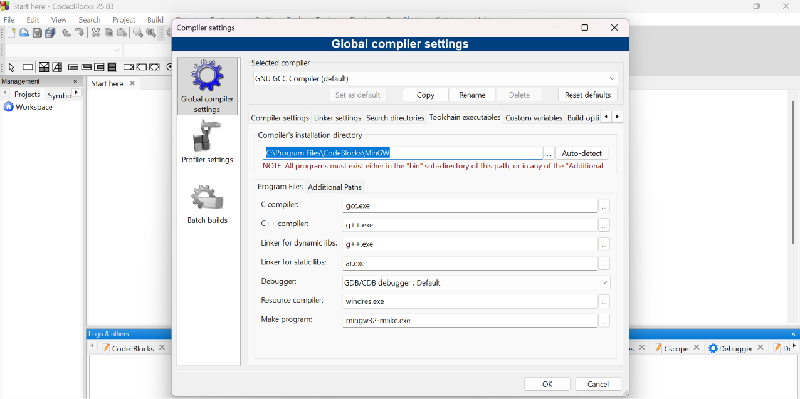

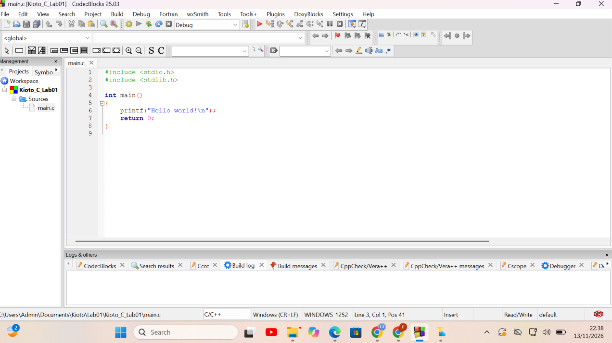

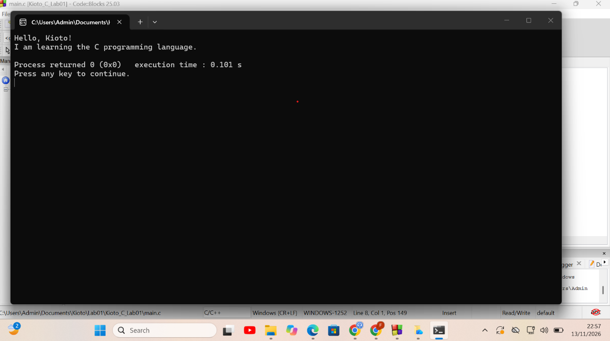

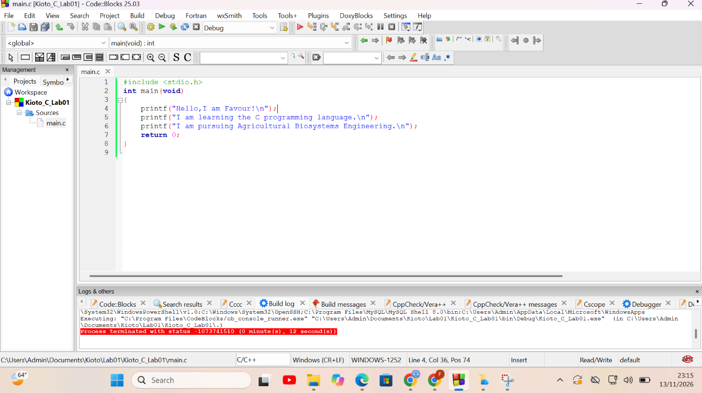

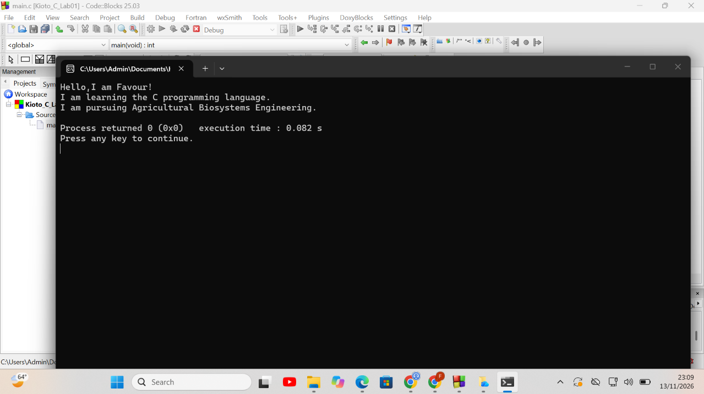

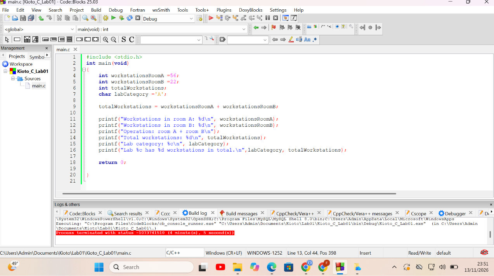

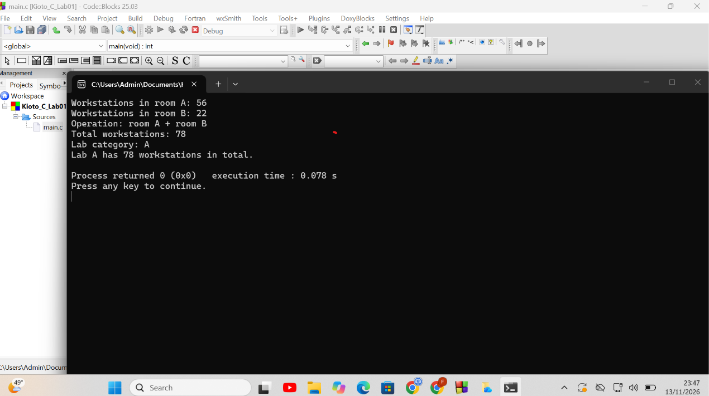

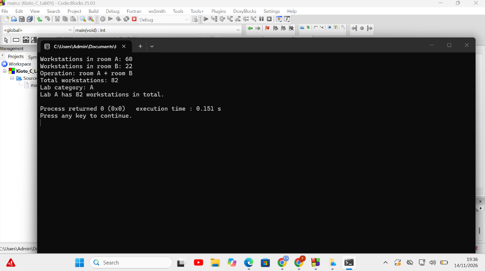

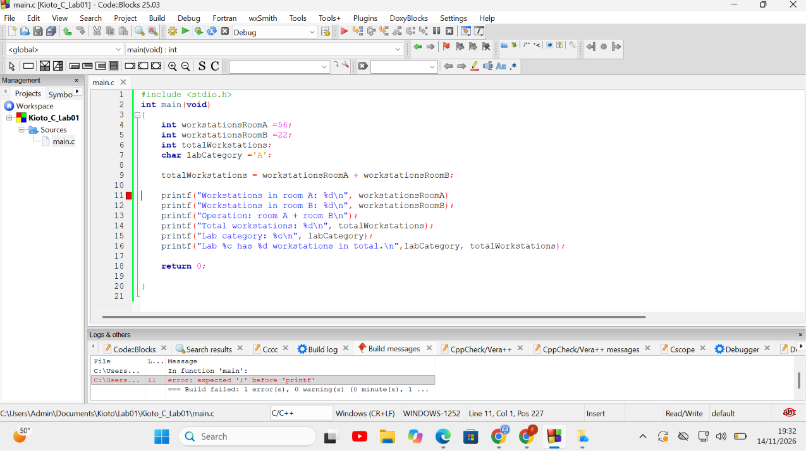

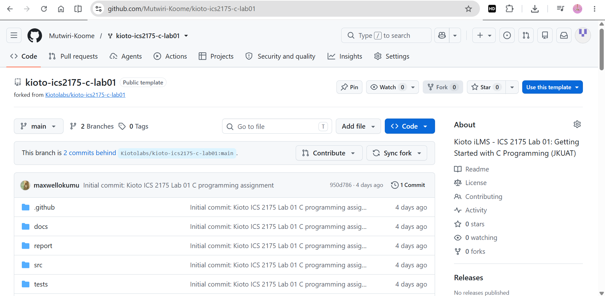

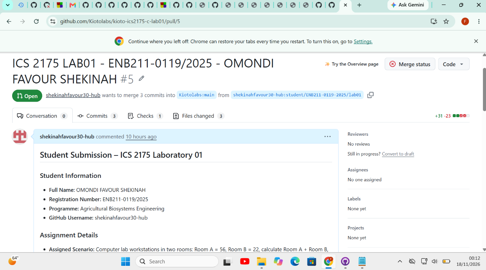

## 12. Individual Reflection

In this laboratory I learned how a C program is built and run. I now understand the parts of a program: #include <stdio.h>, the main() function, statements ending with semicolons, and return 0;. I also learned how to declare variables with suitable data types such as int, float, double and char, and that the format specifier in printf must match the type of the variable. Besides that, I learned the GitHub workflow of forking, branching, committing, pushing and opening a pull request.

The most difficult part was the Git and GitHub submission. Terms like fork, branch and pull request were confusing at first, and I was not sure of the order of the steps. I also made a mistake of forgetting a semicolon, which stopped my program from building until I read the error message and fixed it.The first automated check failed because report/REPORT.md had not been added yet. I added it in my fourth commit, and the new check is awaiting approval from the lecturer.

Next time, I will read all the instructions before I start, check my code for missing semicolons before building, and commit my work after finishing each exercise. I will also write my report as I go along and take my screenshots at each step, so I do not have to go back and repeat them.

## 13. Conclusion

In this laboratory I achieved my objectives. I installed Code::Blocks with the GCC compiler and created a C project. I wrote and ran the Hello Kioto program, declared variables with suitable data types, and completed my personalised calculation of 56 + 22 = 78 total workstations, which I also checked by hand. I tested my programs and fixed a missing semicolon error. I then used Git and GitHub to fork the repository, commit my work on my own branch, and submit a pull request to the lecturer. 