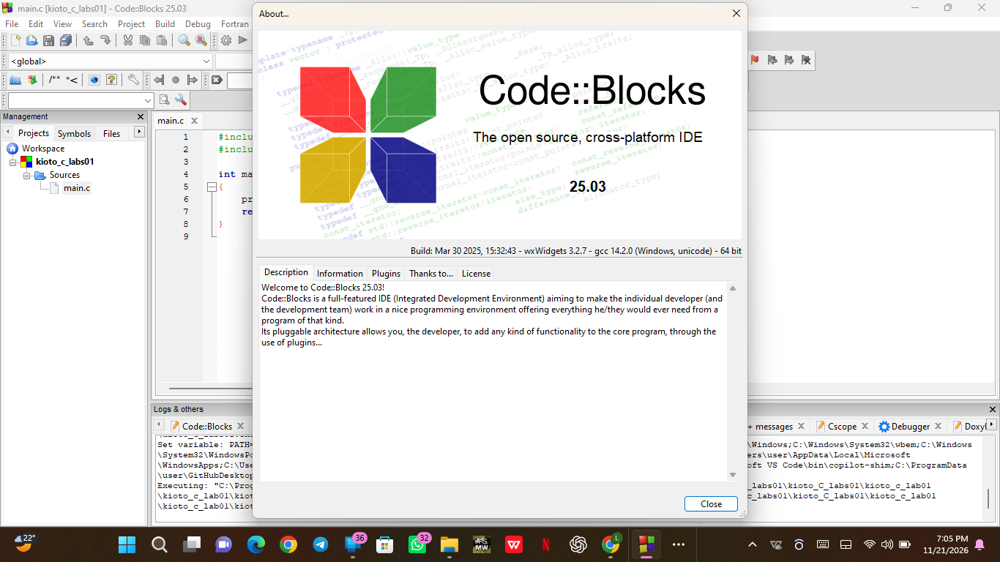
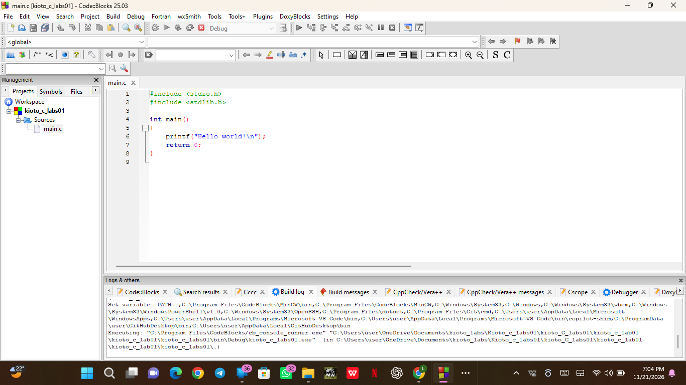
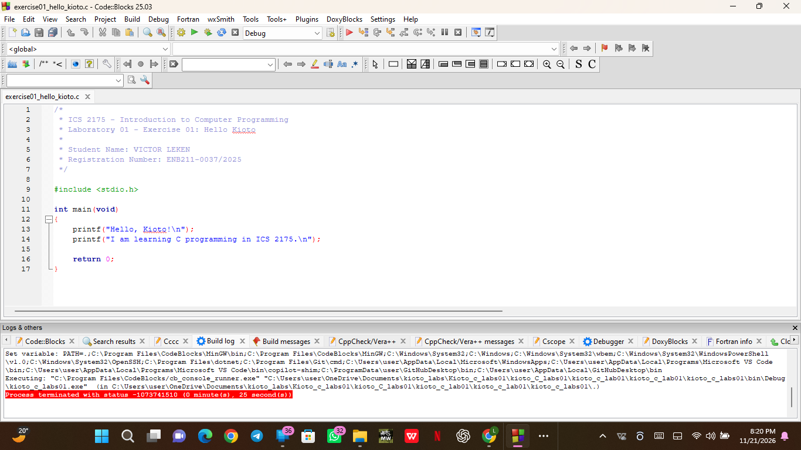
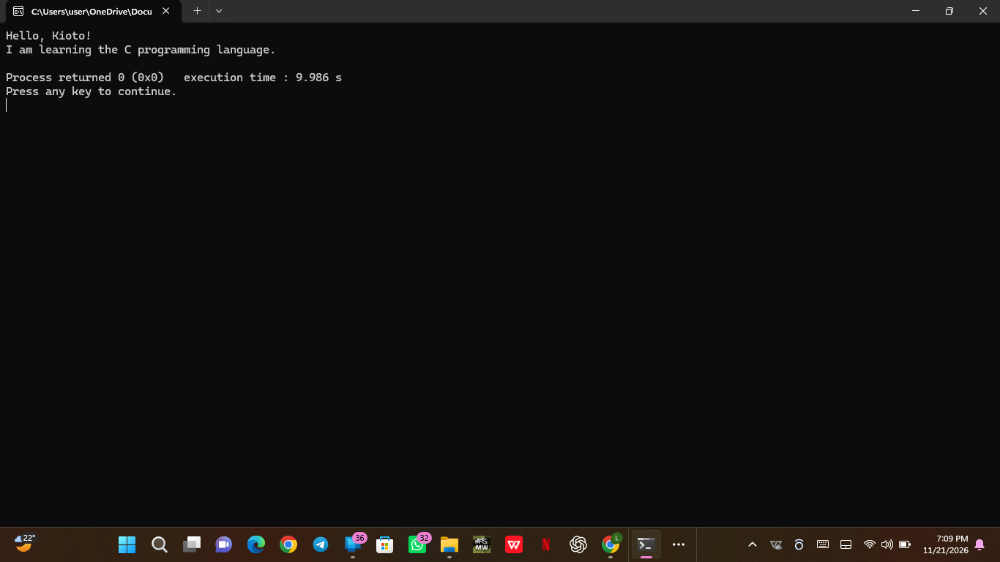
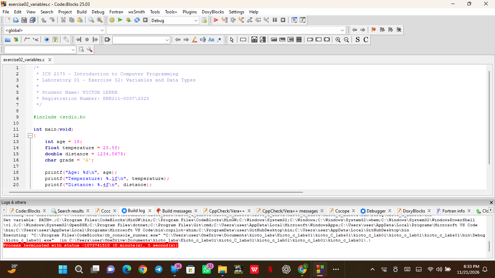
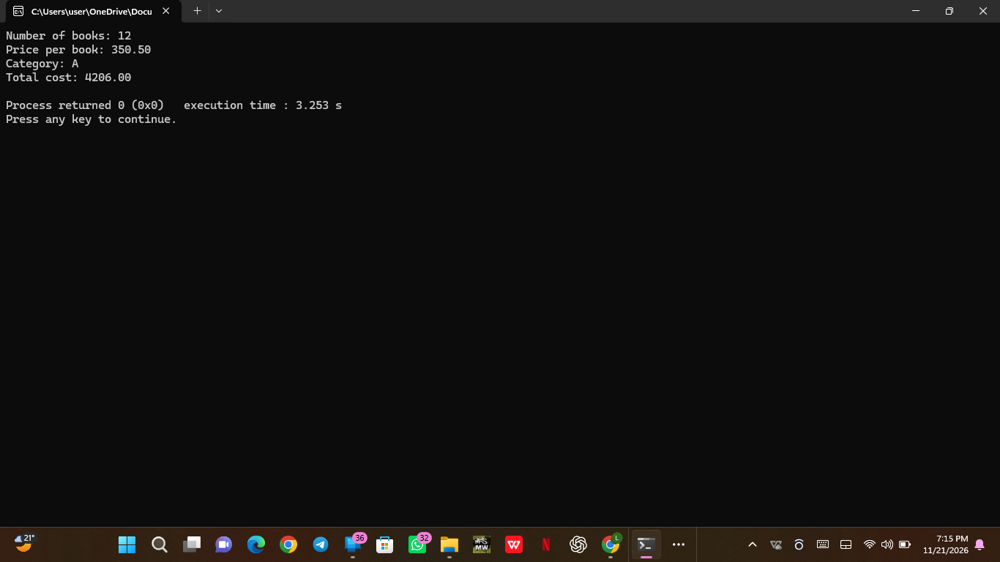
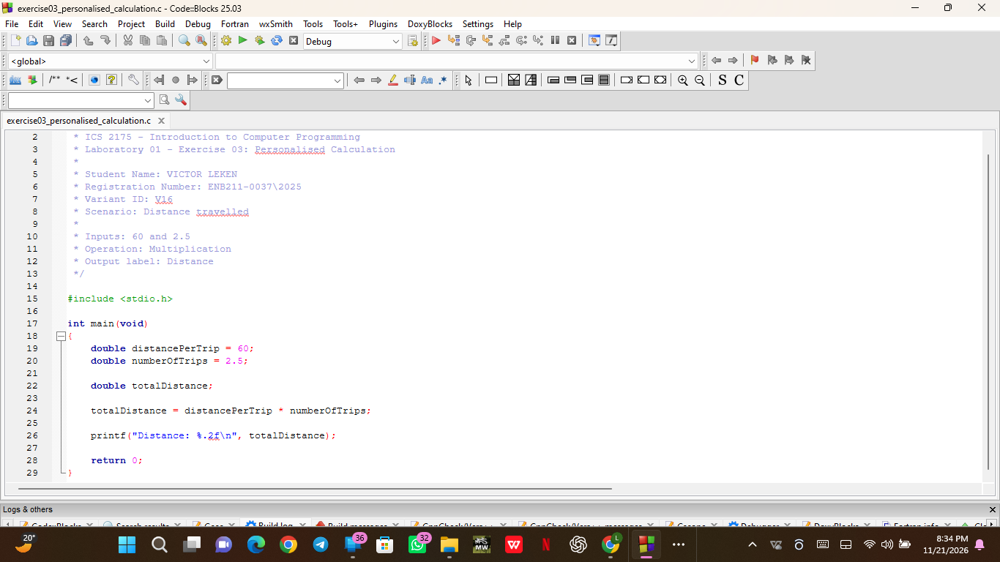
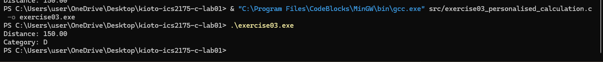

# ICS 2175 – Laboratory 01 Report

## 1. Cover Information

- **Student Full Name:** VICTOR LEKEN
- **Registration Number:** ENB211-0037/2025
- **Programme:** AGRICULTURE AND BIOSYSTEMS ENGINEERING
- **Course Unit:** ICS 2175 – Introduction to Computer Programming
- **Laboratory:** Laboratory 01 – Introduction to C Programming
- **GitHub Username:** Leken-dev
- **Assigned Scenario:** Distance travelled
- **Variant ID:** V16
- **Date:** 21 November 2026

## 2. Objectives

The objectives of this laboratory were:

1. To install and configure a C programming environment using Code::Blocks and the GCC compiler.
2. To understand the basic structure of a C program.
3. To write, compile, and execute simple C programs.
4. To learn how to declare variables and use different data types such as `int`, `float`, `double`, and `char`.
5. To use arithmetic operators to perform calculations in a C program.
6. To practise saving source files, testing program output, and identifying compilation errors.
7. To learn how to use GitHub for version control, including commits, branches, and pull requests.


## 3. Software and Hardware Environment

### 3.1 Software Environment

The laboratory was carried out using the following software:

- **Operating System:** Microsoft Windows
- **Code Editor:** Visual Studio Code
- **IDE:** Code::Blocks (installed/available for the laboratory)
- **Compiler:** GCC 14.2.0 (MinGW-w64)
- **Terminal:** Windows PowerShell
- **Programming Language:** C

### 3.2 Hardware Environment

The laboratory was performed using a personal computer running Windows. The computer was used to write source code, compile programs, execute them in the terminal, and manage the laboratory files.

### 3.3 Development Setup

The GCC compiler was located in the MinGW installation directory. The compiler was tested using the `--version` command in PowerShell, which confirmed that GCC version 14.2.0 was available and functioning correctly.

## 4. Code::Blocks Installation and Configuration

Code::Blocks was used as part of the C programming environment setup. The MinGW toolchain was available on my computer, providing the GCC compiler required to compile C source files into executable programs.

I verified the compiler installation through Windows PowerShell by checking the GCC version. The compiler reported GCC 14.2.0, confirming that it was installed and functioning.

The compiler was located in the following directory:

`C:\Program Files\CodeBlocks\MinGW\bin\gcc.exe`

During configuration and testing, I encountered an issue where PowerShell could not recognize the `gcc` command directly. I resolved this by invoking GCC using its full installation path. This enabled me to compile my C source files successfully.

The setup provided the tools needed to write, compile, execute, and test the laboratory programs.

### Evidence

**Figure 1: Code::Blocks installation and compiler information**



**Figure 2: Laboratory project setup**




## 5. Hello Kioto Implementation

### 5.1 Program Implementation

The first exercise involved writing a simple C program that prints a greeting message and a second line introducing the programming course. I used the `printf()` function to display text in the console.

The program was written as follows:

```c
#include <stdio.h>

int main(void)
{
    printf("Hello, Kioto!\n");
    printf("I am learning C programming in ICS 2175.\n");

    return 0;
}
```

### 5.2 Explanation of the Code

- `#include <stdio.h>` provides access to standard input and output functions such as `printf()`.
- `int main(void)` defines the main function, where program execution begins.
- `printf()` displays text on the screen.
- `\n` moves the cursor to a new line after printing.
- `return 0;` indicates that the program finished successfully.

### 5.3 Program Output

After compiling and executing the program, the following output was displayed:

```text
Hello, Kioto!
I am learning C programming in ICS 2175.
```

The program executed successfully, confirming that the code was correctly written, compiled, and run.

### 5.4 Evidence

**Figure 3: Hello Kioto source code**



**Figure 4: Hello Kioto program output**




## 6. Explanation of C Program Structure

A C program is made up of different parts that work together to execute instructions. In Exercise 1, I used the basic structure of a C program.

### 6.1 Header File

```c
#include <stdio.h>
```

This statement includes the Standard Input/Output header file, which allows the program to use functions such as `printf()` to display messages.

### 6.2 Main Function

```c
int main(void)
```

The `main()` function is the starting point of program execution. The `int` indicates that the function returns an integer value, while `void` indicates that it takes no arguments.

### 6.3 Curly Braces

```c
{
    /* program statements */
}
```

Curly braces define the beginning and end of a block of code. In the program, they enclose the statements belonging to the `main()` function.

### 6.4 Statements

```c
printf("Hello, Kioto!\n");
```

Statements are instructions executed by the computer. Each statement in my program ends with a semicolon. The `printf()` statements display messages in the console.

### 6.5 Return Statement

```c
return 0;
```

This statement terminates the main function and returns the value `0`, indicating that the program completed successfully.

Understanding these components helped me learn how to structure, write, and execute a basic C program.


## 7. Variables and Data Types

In Exercise 2, I learned how to declare variables in C and assign values to them. Variables allow a program to store data that can be used during execution. I used different data types to represent whole numbers, decimal values, and characters.

### 7.1 Variable Declarations

The program used the following variables:

| Variable | Data Type | Example Value | Purpose |
|---|---|---|---|
| `age` | `int` | 18 | Stores a whole number |
| `temperature` | `float` | 25.5 | Stores a decimal value |
| `distance` | `double` | 1234.5678 | Stores a decimal value with greater precision |
| `grade` | `char` | `'A'` | Stores a single character |

### 7.2 Data Types Used

- **`int`** is used to store whole numbers without decimal places.
- **`float`** is used to store numbers that contain decimal places.
- **`double`** is used to store decimal values with greater precision than `float`.
- **`char`** is used to store a single character, such as a letter.

### 7.3 Output Format Specifiers

I used the `printf()` function to display the values stored in the variables. The format specifiers tell the function how to display each type of value.

| Format Specifier | Purpose |
|---|---|
| `%d` | Displays an integer |
| `%f` | Displays a floating-point number |
| `%.1f` | Displays a decimal number to 1 decimal place |
| `%.4f` | Displays a decimal number to 4 decimal places |
| `%c` | Displays a single character |

This exercise helped me understand how data types determine the kind of information a variable can store and how format specifiers are used to display that information correctly.

### 7.4 Evidence

**Figure 5: Exercise 2 source code**



**Figure 6: Exercise 2 output**




## 8. Personalised Calculation

### 8.1 Assigned Scenario

My assigned scenario was **Distance Travelled**, with Variant ID **V16**. The program was designed to calculate the total distance by multiplying the distance value by the number of trips.

### 8.2 Variables and Values

The program used the following variables:

| Variable | Data Type | Value | Description |
|---|---|---:|---|
| `distancePerTrip` | `double` | 60 | Distance for each trip |
| `numberOfTrips` | `double` | 2.5 | Number of trips used in the calculation |
| `totalDistance` | `double` | Calculated | Stores the final distance |
| `category` | `char` | `'D'` | Stores a single character category |

### 8.3 Source Code

```c
#include <stdio.h>

int main(void)
{
    double distancePerTrip = 60;
    double numberOfTrips = 2.5;
    double totalDistance;
    char category = 'D';

    totalDistance = distancePerTrip * numberOfTrips;

    printf("Distance: %.2f\n", totalDistance);
    printf("Category: %c\n", category);

    return 0;
}
```

### 8.4 Calculation and Result

The program used multiplication to calculate the total distance.

\[
\text{Total Distance} = \text{Distance per Trip} \times \text{Number of Trips}
\]

Substituting the values:

\[
60 \times 2.5 = 150
\]

Therefore, the calculated result was **150.00**.

I independently checked the result by multiplying 60 by 2.5 using the same arithmetic operation. The result was 150, which matched the program output.

### 8.5 Program Output

```text
Distance: 150.00
Category: D
```

### 8.6 Evidence

**Figure 7: Exercise 3 source code**



**Figure 8: Exercise 3 program output**




## 9. Testing and Troubleshooting

### 9.1 Program Testing

I tested my C programs by compiling the source files using GCC and executing the generated executable files through Windows PowerShell. I checked the output to confirm that the programs displayed the expected results.

Exercise 1 was successfully compiled and executed, producing the expected greeting messages.

### 9.2 Errors Encountered

During the laboratory, I encountered several issues:

**1. GCC command not recognized**

Initially, PowerShell could not recognize `gcc` as a command. I checked the compiler installation and found GCC inside the MinGW directory installed under Code::Blocks. I resolved this by using the full path to `gcc.exe`.

**2. Source file not found**

When I attempted to compile Exercise 1 while in the user directory, the compiler could not locate the source file. I corrected this by navigating to the laboratory project directory before compiling.

**3. Executable not found**

When I tried to run Exercise 3 before compiling it, PowerShell reported that `exercise03.exe` could not be found. This happened because the executable had not yet been created. The solution was to compile the source file first and then run the generated executable.

### 9.3 Verification

After correcting the file path and compiler command, I successfully compiled and executed Exercise 1. The console displayed:

```text
Hello, Kioto!
I am learning C programming in ICS 2175.
```

This confirmed that the compiler was working and that the program executed correctly.

Testing and troubleshooting helped me understand the importance of using the correct working directory, locating the compiler, compiling source code before running it, and checking error messages carefully.


## 10. GitHub Workflow

### 10.1 Repository and Branch

I used GitHub to manage and submit my Laboratory 01 files. I worked on my own branch instead of making changes directly to the main branch.

- **GitHub Username:** Leken-dev
- **Feature Branch:** `student/ENB211-0037/2025/lab01`
- **Target Repository:** Kiotolabs/kioto-ics2175-c-lab01
- **Pull Request:** #44 – Student Submission – ICS 2175 Laboratory 01

### 10.2 Commits

I made 14 commits to record the progress of my laboratory work. The commits included adding screenshots, creating the report, and updating the source code for the three exercises.

Commits helped me keep track of changes and provided a record of the work completed during the laboratory.

### 10.3 Pull Request

I opened Pull Request #44 to propose merging my laboratory branch into the original repository's `main` branch. The pull request allows the submitted work to be reviewed before it is merged.

A pull request is useful because it provides a place to review code changes, discuss the submission, and check the work before integration.

### 10.4 Submission Evidence

The pull request shows my branch name, commit history, submitted files, and the proposed changes.

**Pull Request:** [Student Submission – ICS 2175 Laboratory 01 #44](https://github.com/Kiotolabs/kioto-ics2175-c-lab01/pull/44)


## 11. Screenshots and Evidence

Screenshots were captured during the laboratory to provide evidence of the programming environment setup, source code implementation, and successful execution of the programs. They help demonstrate the steps followed and the results obtained.

The screenshots included in this report cover the following areas:

| Figure | Description |
|---|---|
| Figure 1 | Code::Blocks installation and compiler information |
| Figure 2 | Laboratory project setup |
| Figure 3 | Exercise 1 – Hello Kioto source code |
| Figure 4 | Exercise 1 – Hello Kioto program output |
| Figure 5 | Exercise 2 – Variables and data types source code |
| Figure 6 | Exercise 2 – Variables and data types program output |
| Figure 7 | Exercise 3 – Personalised calculation source code |
| Figure 8 | Exercise 3 – Personalised calculation program output |

The screenshots were organized in the `report/SCREENSHOTS/` directory to keep the report evidence together and make it easier to locate each image.

These screenshots provide visual evidence of the work completed during the laboratory and support the explanations presented in the report.


## 12. Reflection and Lessons Learned

This laboratory helped me develop a basic understanding of C programming and the process of writing, compiling, and executing programs. I learned how to structure a C program using header files, the `main()` function, statements, and return values.

I also learned how to declare variables and use different data types, including `int`, `float`, `double`, and `char`. Through the exercises, I gained experience using `printf()` to display information and arithmetic operators to perform calculations.

During the laboratory, I encountered challenges related to locating the GCC compiler, navigating to the correct project directory, and running executable files. I overcame these challenges by checking the compiler installation, using the correct file paths, and ensuring that I compiled my source code before running the programs.

I also gained experience using GitHub to manage my laboratory files, record changes through commits, and submit my work using a pull request.

Overall, this laboratory improved my confidence in using the C programming environment and helped me develop problem-solving skills that will be useful in future programming exercises.


## 13. Conclusion

Laboratory 01 provided an introduction to C programming and the basic steps involved in developing and executing a C program. I successfully set up the programming environment, learned the basic structure of a C program, and practised using variables, data types, output statements, and arithmetic operations.

The exercises helped me understand how source code is written, compiled using GCC, and executed to produce results. I also gained practical experience troubleshooting compiler and file path issues.

In addition, I learned how GitHub can be used to manage source code, track changes, and submit programming assignments through pull requests.

The knowledge and skills gained from this laboratory will provide a foundation for more advanced C programming concepts and future laboratory exercises.