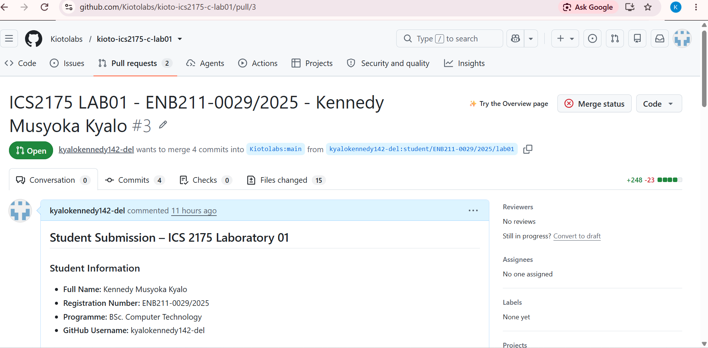

# ICS 2175 – Laboratory 01 Report

## 1. Cover Information

- **Student Full Name:** Kennedy Musyoka Kyalo
- **Registration Number:** ENB211-0029/2025
- **Programme:** BSc. Computer Technology
- **GitHub Username:** kyalokennedy142-del
- **Assigned Scenario:** Room A and Room B workstation calculation
- **Variant ID:** V21
- **Date:** 16 November 2026

## 2. Objectives

The objectives of this laboratory were:

1. To install and configure Code::Blocks and the GCC compiler.
2. To understand the basic structure of a C program.
3. To write, compile and execute a simple C program.
4. To understand variables and basic C data types.
5. To perform arithmetic calculations using variables.
6. To practise identifying and correcting programming errors.
7. To use GitHub for version control and submission of programming work.

## 3. Software and Hardware Environment

- **Operating System:** Windows 11 (Build 26200.8037)
- **IDE:** Code::Blocks 25.03
- **Compiler:** GNU GCC 14.2.0 (MinGW-W64)
- **Programming Language:** C
- **Hardware:** HP EliteBook 830 G6, 8 GB RAM

## 4. Code::Blocks Installation and Configuration

I installed Code::Blocks 25.03 with the MinGW/GCC compiler on my Windows computer.

I opened Code::Blocks and confirmed that the GNU GCC Compiler was available. I created a C console project and used the IDE to write and test C programs.

I also used the GCC compiler from PowerShell when necessary to compile and run programs.

The successful rebuild of my project produced zero errors and zero warnings.

**Evidence:** Code::Blocks About dialog, project window and successful build log screenshots.

## 5. Hello Kioto Implementation

For Exercise 1, I created a C program that displays a greeting and introduces my academic programme.

The program uses `printf()` to display two lines of text.

**Code:**

```c
#include <stdio.h>

int main(void)
{
    printf("Hello, Kioto!\n");
    printf("I am a student of BSc. Computer Technology at JKUAT.\n");

    return 0;
}
```

**Program output:**

```text
Hello, Kioto!
I am a student of BSc. Computer Technology at JKUAT.
```

The program executed successfully.

## 6. Explanation of C Program Structure

- **`#include <stdio.h>`:** Includes the standard input/output library, which provides functions such as `printf()`.
- **`int main(void)`:** Defines the main function, where program execution begins.
- **Braces `{ }`:** Mark the beginning and end of a function or code block.
- **Statements:** Instructions executed by the program. Most C statements end with a semicolon.
- **`printf()`:** Displays text and values on the screen.
- **`return 0;`:** Indicates that the program completed successfully.
- **`\n`:** Moves the output cursor to a new line.

## 7. Variables and Data Types

In Exercise 2, I declared and initialised four variables using different C data types.

- `int age = 25;` stores a whole number.
- `float average = 76.5f;` stores a decimal number.
- `double distance = 98.765432;` stores a decimal number with greater precision.
- `char initial = 'K';` stores a single character.

I used the following format specifiers:

- `%d` for integers.
- `%.1f` for a floating-point value displayed to one decimal place.
- `%.6f` for a decimal value displayed to six decimal places.
- `%c` for a character.

**Program output:**

```text
Age: 25 years
Average: 76.5
Distance: 98.765432
Initial: K
```

## 8. Personalised Calculation

For Exercise 3, I used my assigned V21 scenario, which calculates the total number of study hours.

The input values were:

- Study hours per day = 4 hours.
- Number of days = 5 days.

**Source code:**

```c
#include <stdio.h>

int main(void)
{
    int studyHoursPerDay = 4;
    int numberOfDays = 5;
    int totalStudyHours;

    totalStudyHours = studyHoursPerDay * numberOfDays;

    printf("Total study hours: %d\n", totalStudyHours);

    return 0;
}
```

**Calculation:**

```text
totalStudyHours = studyHoursPerDay * numberOfDays
totalStudyHours = 4 * 5
totalStudyHours = 20
```

**Program output:**

```text
Total study hours: 20
```

I independently checked the result by multiplying 4 by 5, which gives 20. The program produced the expected result.

**Variant ID:** V21

## 9. Testing and Troubleshooting

I compiled and executed my programs using Code::Blocks and the GCC compiler.

I performed the following tests:

1. Compiled and executed the Hello Kioto program.
2. Tested variables and different data types.
3. Tested the personalised workstation calculation.
4. Performed a rebuild of the Code::Blocks project.
5. Confirmed that the successful build produced zero errors and zero warnings.

During testing, I encountered a compilation error caused by a missing `#include <stdio.h>` declaration. The compiler indicated that `printf()` had not been declared.

I corrected the error by adding the required header and rebuilt the program successfully.

## 10. GitHub Workflow

I used GitHub to manage and prepare my laboratory work for submission.

My GitHub username is `kyalokennedy142-del`.

I completed the following steps:

1. Forked the official Kioto ICS 2175 Laboratory 01 repository.
2. Cloned my fork to my computer.
3. Created a feature branch named `student/ENB211-0029/2025/lab01`.
4. Completed the three programming exercises.
5. Created three meaningful commits:
   - Complete Exercise 1: Hello Kioto
   - Complete Exercise 2: Variables and Data Types
   - Complete Exercise 3: Personalised Calculation
6. Pushed my changes to my GitHub fork.
7. Created Pull Request #3 to submit my work to the original repository.

A commit records changes in the repository's history. A pull request allows the changes to be reviewed before they are merged into the original repository.

**Repository:** https://github.com/kyalokennedy142-del/kioto-ics2175-c-lab01

**Pull Request:** https://github.com/Kiotolabs/kioto-ics2175-c-lab01/pull/3

**Pull Request status:** Open – awaiting review.

## 11. Screenshots and Evidence

The following screenshots provide evidence of my laboratory work. They are stored in the `report/evidence/` folder.

1. Code::Blocks 25.03 About dialog – `evidence_01_codeblocks_about.png`
2. Code::Blocks project showing the source file – `evidence_02_project_open.png`
3. Successful build log showing zero errors and zero warnings – `evidence_03_successful_build.png`
4. Exercise 1 running in the console – `evidence_04_exercise01_output.png`
5. Exercise 2 running in the console – `evidence_05_exercise02_output.png`
6. Exercise 3 running in the console – `evidence_06_exercise03_output.png`
7. GitHub fork repository – `evidence_07_github_fork.png`
8. Feature branch on GitHub – `evidence_08_feature_branch.png`
9. GitHub commits – `evidence_09_three_commits.png`
10. Open Pull Request #3 – `evidence_10_pull_request.png`
11. Exercise 1 source code open in Code::Blocks – `evidence_11_exercise01_source.png`
12. Exercise 2 source code open in Code::Blocks – `evidence_12_exercise02_source.png`
13. Exercise 3 source code open in Code::Blocks – `evidence_13_exercise03_source.png`

**Pull Request evidence:**



## 12. Individual Reflection

Through this laboratory, I gained practical experience writing and executing programs in C.

I learned how to use the `stdio.h` library, define the main function, display output using `printf()`, and declare variables using different data types.

I also learned how to perform arithmetic operations and store results in variables.

One of the challenges I encountered was identifying and correcting compilation errors. I learned that missing header files and syntax errors can prevent a program from compiling.

I also gained experience using GitHub to manage source code through repositories, branches and commits.

In future programming tasks, I will pay more attention to syntax, test my programs regularly and organise my code carefully.

## 13. Conclusion

This laboratory introduced me to the fundamentals of C programming and the practical use of an integrated development environment.

I successfully completed and tested the three programming exercises, covering basic output, variables, data types and arithmetic calculations.

I also gained experience with GCC, Code::Blocks and GitHub version control.

The laboratory provided a foundation for further study of programming and software development.