# ICS 2175 – Laboratory 01 Report

## 1. Cover Information

- **Student Full Name:** Victor Koome Mutwiri
- **Registration Number:** ENB211-0042/2025
- **Programme:** Bsc. Agriculture and Biosystems Engineering
- **GitHub Username:** @Mutwiri-Koome
- **Assigned Scenario:** Printing costs
- **Variant ID:** V10
- **Date:** 17/11/2026

## 2. Objectives

The main objectives of this laboratory were to:
- Install and configure the Code::Blocks IDE and the GNU GCC C compiler on Windows.
- Understand the fundamental structure and syntax rules of a C program.
- Write, compile, and execute a basic C console program (`Hello Kioto`).
- Declare, initialize, and display variables using standard C data types (`int`, `float`, and `char`) and format specifiers.
- Implement and independently verify an arithmetic calculation based on an assigned personal scenario.
- Practise a structured Git and GitHub workflow involving forking, branching, committing, and submitting a Pull Request.


## 3. Software and Hardware Environment

- **Operating System:** Windows 11
- **IDE:** Code::Blocks 25.03
- **Compiler:** GNU GCC Compiler
- **Hardware:** Hp ZBook firefly, Intel Core i7, 32GB RAM

## 4. Code::Blocks Installation and Configuration

I installed the Code::Blocks bundle containing the MinGW GNU GCC compiler on Windows. After launching Code::Blocks, I verified that the GNU GCC Compiler was auto-detected under **Settings > Compiler > Toolchain executables**. Instead of creating a new project that would overwrite the repository structure, I enabled the left-hand **Management** pane (**View > Manager** / `Shift + F2`) and opened the starter `.c` source files directly from the cloned `src/` directory.


## 5. Hello Kioto Implementation

In `src/exercise01_hello_kioto.c`, I completed the greeting output using `printf()` statements to display `"Hello, Kioto!"` and introduce my programme (`BSc. Agriculture and Biosystems Engineering`) on separate console lines using the `\n` newline escape sequence.

```c
#include <stdio.h>

int main(void)
{
    printf("Hello, Kioto!\n");
    printf("I am studying Agriculture and Biosystems Engineering at JKUAT and learning C programming.\n");

    return 0;
}
```

### Controlled Experiments (Checkpoint B)
Following the lab instructions, I performed controlled modifications to observe how the compiler and runtime output responded:
- **Changing the greeting text:** Modifying the text inside the double quotation marks `"..."` compiled and ran without any errors because string literals are treated as plain text data by the compiler rather than C syntax commands.
- **Removing a semicolon / terminating quote:** Removing the semicolon from a `printf()` statement (and testing a missing terminating quote on line 7) caused compilation to fail immediately with the errors `error: missing terminating " character`, `error: expected expression before 'return'`, and `error: expected ';' before '}' token`. Restoring the missing punctuation resolved the build errors.
- **Removing `\n`:** Removing the `\n` escape sequence allowed the program to compile cleanly, but consecutive `printf()` statements printed continuously on the same console line without a line break. Restoring `\n` separated the output lines properly.

## 6. Explanation of C Program Structure

Every C program follows a strict, modular structure:
- **`#include <stdio.h>`:** A preprocessor directive that includes the Standard Input/Output library header so functions such as `printf()` can be called.
- **`int main(void)`:** The mandatory entry point function where program execution begins. The `int` return type indicates that the function returns an integer exit status to the operating system.
- **Curly Braces `{ }`:** Mark the opening and closing boundaries of a block of code, grouping all statements inside `main()`.
- **Statements and Semicolons `;`:** Every executable C instruction is a statement that must terminate with a semicolon so the compiler knows where one instruction ends and the next begins.
- **`return 0;`:** Ends execution of `main()` and returns `0` to the operating system to indicate successful completion.

## 7. Variables and Data Types

In `src/exercise02_variables.c`, I declared and initialized variables using core C data types and displayed them using matching `printf` format specifiers:
- **`int` (`%d`):** Stores whole integers without fractional parts accurately in memory.
- **`float` (`%.1f`):** Stores real numbers containing decimal points (using the `f` suffix such as `1.5f`), with `%.1f` formatting the output to one decimal place.
- **`double` (`%.3lf`):** Stores double-precision floating-point values accurately in memory.
- **`char` (`%c`):** Stores a single ASCII character enclosed in single quotes (such as `'B'`).

```c
#include <stdio.h>

int main(void)
{
    int average_speed = 48;
    float time = 1.5f;
    double fuel_efficiency = 14.756;
    char vehicle_category = 'B';

    printf("Average speed (km/h): %d\n", average_speed);
    printf("Time taken (hours): %.1f\n", time);
    printf("Fuel efficiency (km/l): %.3lf\n", fuel_efficiency);
    printf("Vehicle category: %c\n", vehicle_category);

    return 0;
}
```

## 8. Personalised Calculation

- **Variant ID:** `V10`
- **Assigned Scenario:** Printing costs
- **Input Values:**
  - `quantity` (`int`): `120` prints
  - `unit_price` (`float`): `2` Ksh per print
- **Operation and Independent Verification:**
  Using the formula `print_cost = quantity * unit_price`, the program multiplies `quantity` (`120`) by `unit_price` (`2`) and stores the product in the `float` variable `print_cost`. Calculating manually ($120 \times 2 = 240$) independently verified the program's output of `Printing cost: 240`.

```c
/*
 * ICS 2175 - Introduction to Computer Programming
 * Laboratory 01 - Exercise 03: Personalised Calculation
 *
 * Student Name: VICTOR KOOME MUTWIRI
 * Registration Number: ENB211-0042/2025
 * Variant ID: V10
 * Scenario: Printing costs
 *
 * Instructions:
 *   - Record your assigned variant details above.
 *   - Use the two input values given for your variant.
 *   - Perform the required arithmetic operation.
 *   - Store the result in a meaningfully named variable.
 *   - Print the result using the required output label.
 */

#include <stdio.h>

int main(void)
{
    int quantity = 120;
    float unit_price = 2;

    float print_cost;

    print_cost = quantity * unit_price;

    printf("The number of prints to be made are %d\n", quantity);
    printf("The price per print will be Ksh %.2f\n", unit_price);
    printf("Printing cost: %.0f\n", print_cost);

    return 0;
}
```

## 9. Testing and Troubleshooting

Each `.c` file was built and executed in Code::Blocks 25.03 (`Build and Run`) to verify `0 error(s), 0 warning(s)` before inspecting the console output. Key errors tested and resolved during the lab included:
- **Intentional Syntax Experiment (Exercise 1):** Removing statement punctuation on line 7 triggered `error: expected expression before 'return'` and `error: expected ';' before '}' token` in the Build messages log. Restoring the terminating character and semicolon fixed the build.
- **Spaces in Variable Identifiers (Exercise 2 / 3):** Declaring multi-word variables with spaces (`int average speed = 48;` and `float unit price = 2;`) produced compiler errors (`error: expected '=', ',', ';', 'asm' or '__attribute__' before 'speed'` and `error: 'speed' undeclared`) because C variable names cannot contain spaces. Renaming identifiers using snake_case (`average_speed`, `unit_price`, `print_cost`) and correcting the format specifiers resolved all compilation errors.


## 10. GitHub Workflow

1. **Fork:** Forked the upstream repository `Kiotolabs/kioto-ics2175-c-lab01` to my personal GitHub account at `https://github.com/Mutwiri-Koome/kioto-ics2175-c-lab01`.
2. **Clone & Branch:** Cloned the fork locally via GitHub Desktop and worked on my personal branch `student/ENB211-0042-2025/lab01`.
3. **Commit & Push:** Committed the completed C source files (`src/*.c`), report (`report/REPORT.md`), evidence checklist (`report/EVIDENCE_CHECKLIST.md`), and screenshots (`report/screenshots/*`) with descriptive commit messages and pushed them to `origin`.
4. **Pull Request:** Opened Pull Request `#8` targeting `Kiotolabs/kioto-ics2175-c-lab01:main` (`https://github.com/Kiotolabs/kioto-ics2175-c-lab01/pull/8`) and left it open for automated validation and lecturer review.

## 11. Screenshots

### Exercise 01 — Hello Kioto (Source Code, Intentional Syntax Experiment, and Console Output)
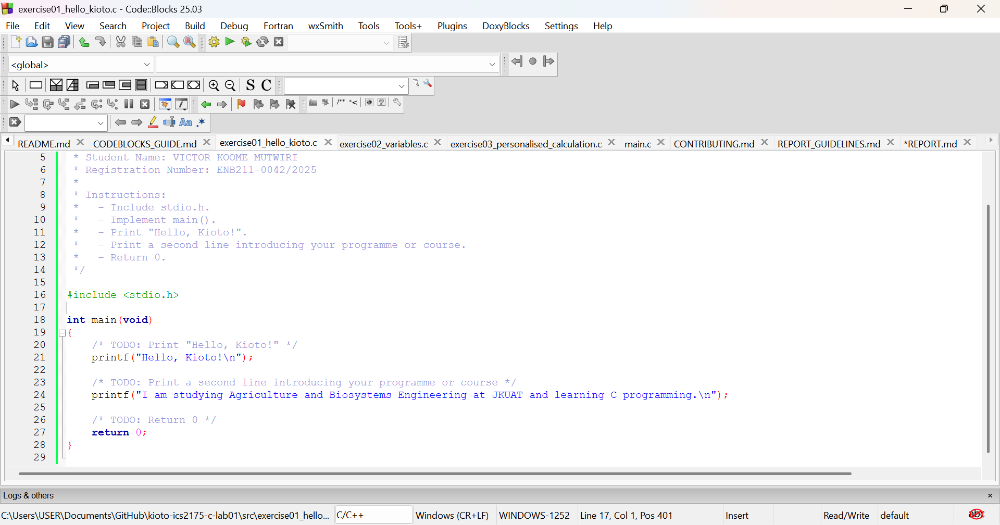
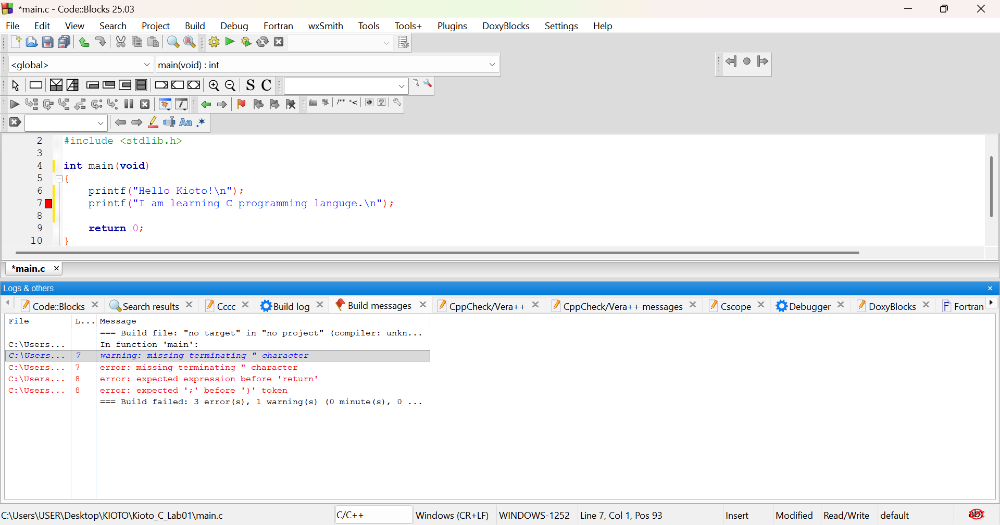
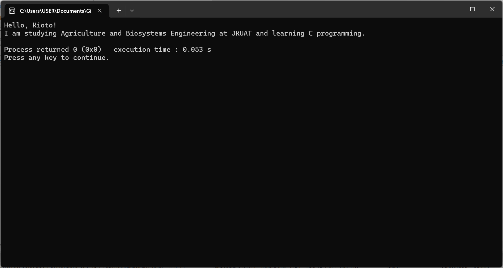

### Exercise 02 — Variables and Data Types (Source Code, Identifier Spacing Error, and Console Output)
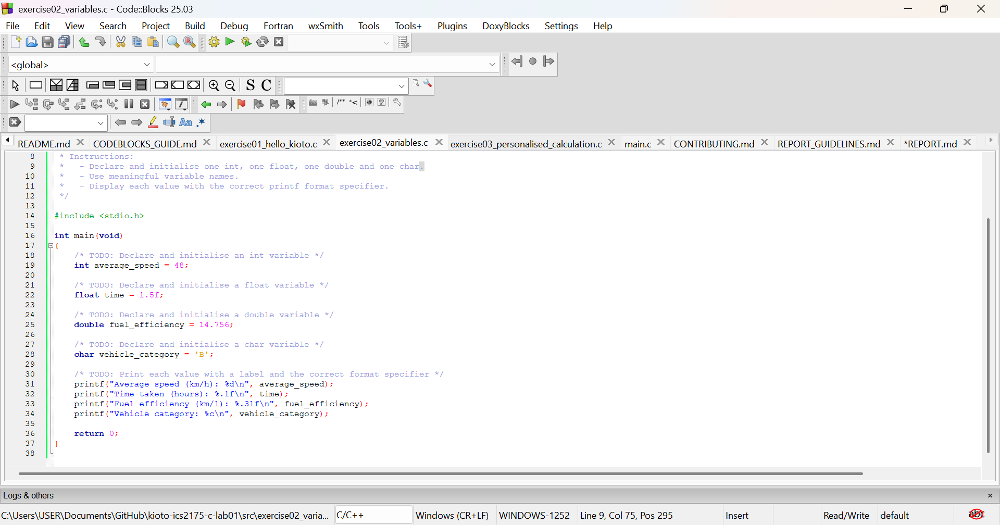
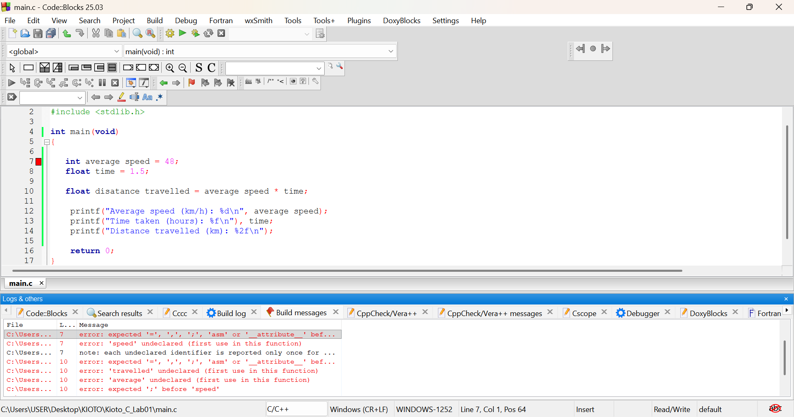
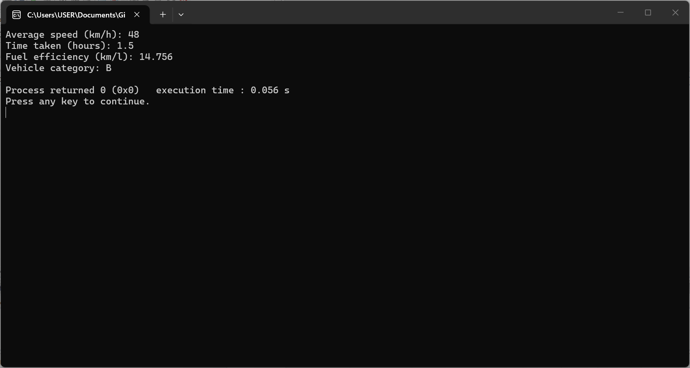

### Exercise 03 — Personalised Calculation (Source Code and Console Output)
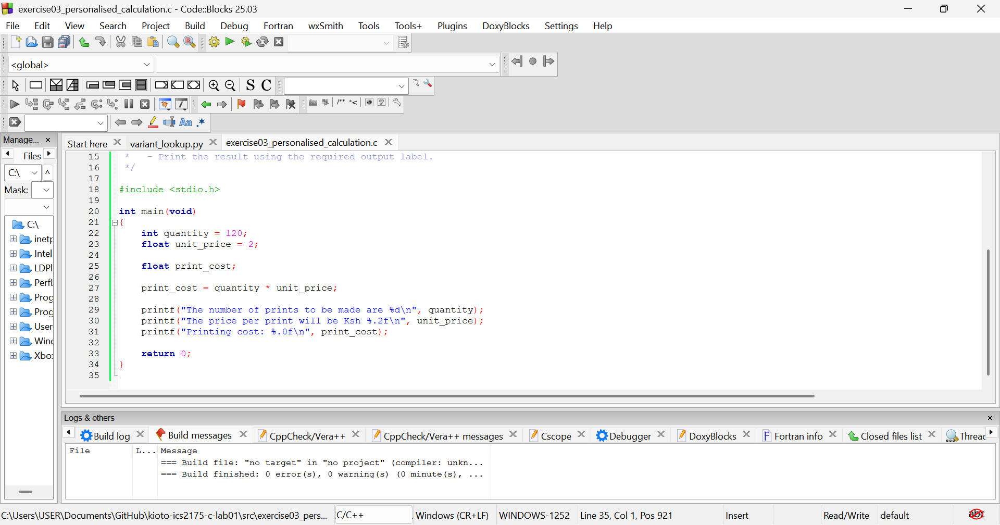
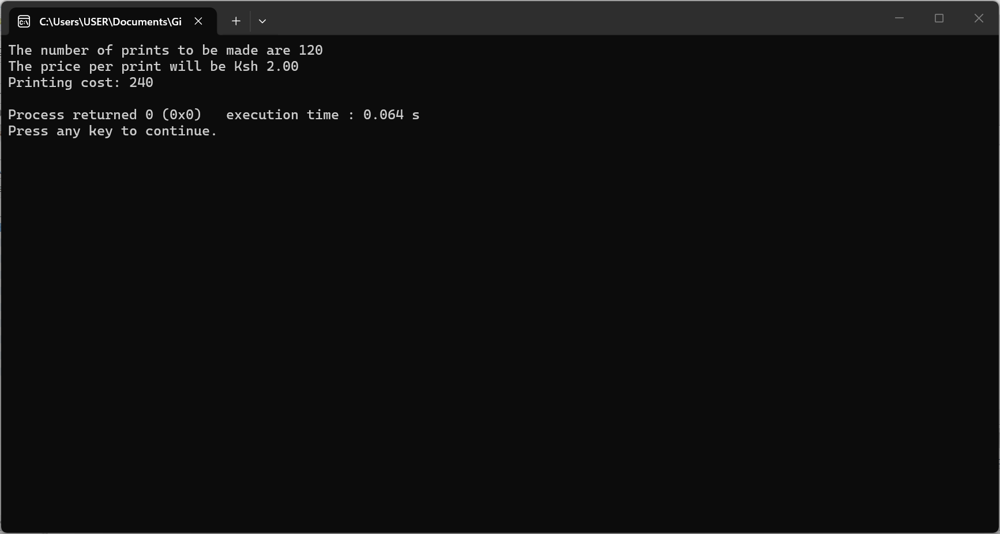

### GitHub Workflow (Fork, Feature Branch, Commits, and Pull Request)

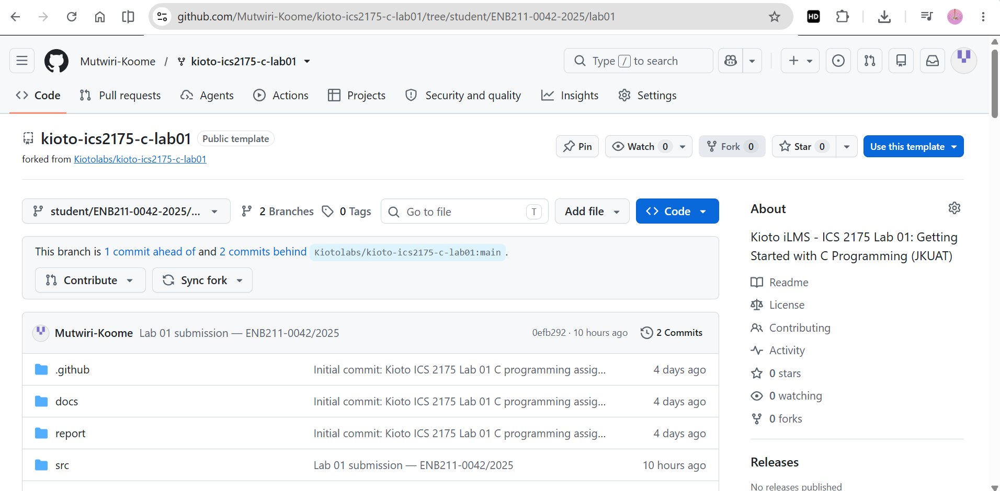
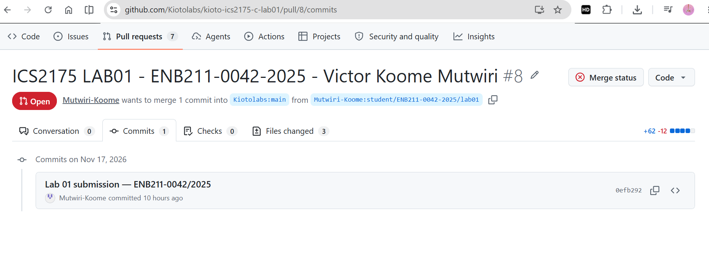
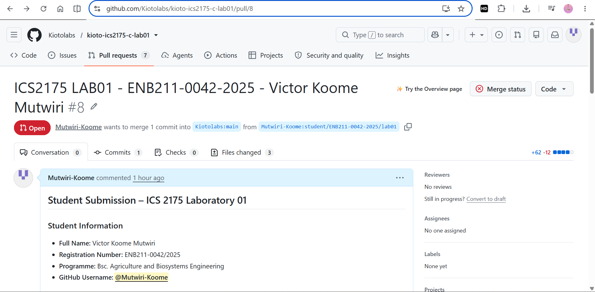

### Code::Blocks Installation / About Dialog
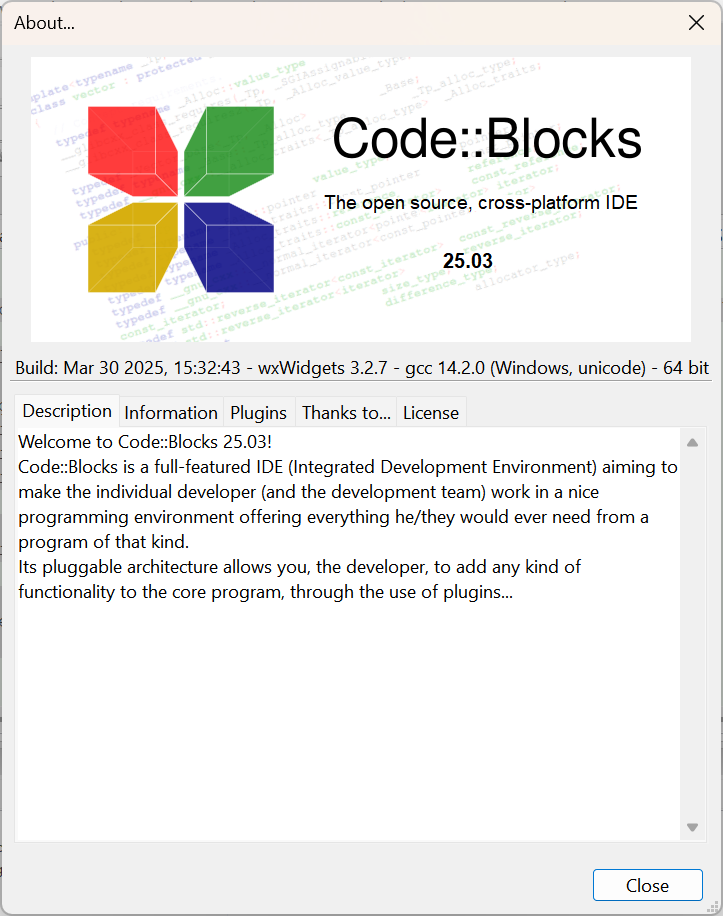

## 12. Individual Reflection
- **What I Learned:** I learned how C programs are structured, why strict punctuation like semicolons and quotes matters to the compiler whereas string literal contents can change freely, how format specifiers (`%d`, `%c`, `%.2f`) format console output, and how GitHub forks, branches, commits, and Pull Requests track software revisions.
- **What Was Difficult:** Understanding how local file edits in Code::Blocks connect to GitHub Desktop commits and cross-fork Pull Requests—as well as realizing that `REPORT.md` and screenshot files live inside the repository folder itself—was initially challenging.
- **What I Will Do Differently Next Time:** In future labs, I will read all documentation files in `docs/` completely before writing code, verify identifier naming rules carefully, and push incremental commits after each exercise.

## 13. Conclusion

All objectives of Laboratory 01 were successfully achieved. Code::Blocks 25.03 and the GCC compiler were properly configured, all three C exercises compiled and ran cleanly, the controlled syntax experiments and personalised printing cost calculation ('240') were verified, and the full codebase, report, and screenshot evidence were submitted via Pull Request `#8` on GitHub.


