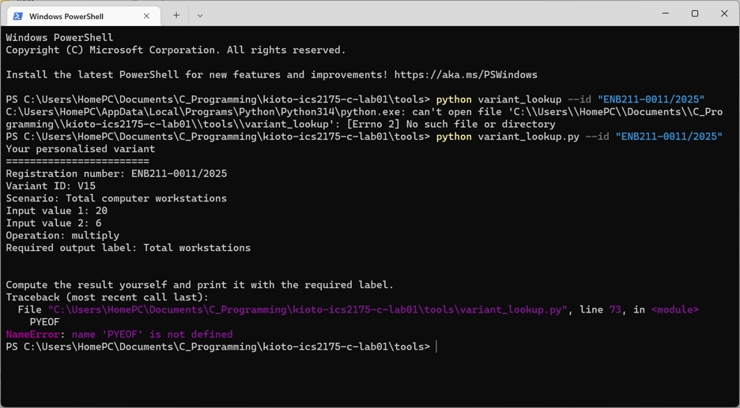

# ICS 2175 – Laboratory 01 Report

## 1. Cover Information

- **Student Full Name:** MURIUKI RISPER MUKAMI
- **Registration Number:** ENB211-0011/2025
- **Programme:** Bsc in Agricultural and Biosystems Engineering
- **GitHub Username:** mukamimuriuki-ui
- **Assigned Scenario:** Total Computer Workstations
- **Variant ID:** V15
- **Date:** 18-11-2026

## 2. Objectives

To set up a C programme environment on Windows using Code::Blocks and GCC, to write, compile and run basic C programs.
To practise declaring variables of different data types and displaying them with printf.
To submit my work using Git and Github through a fork, a branch and a pull request.

## 3. Software and Hardware Environment

- **Operating System:** Windows 11
- **IDE:** Code::Blocks (25.03)
- **Compiler:** GCC 14.2.0 (MinGW-W64 x86_64-ucrt-posix-seh)
- **Hardware:**  HP Elitebook 845 G7 Notebook PC (AMD Ryzen 55 PRO 4655OU, 16 GB RAM)

## 4. Code::Blocks Installation and Configuration

I opened the official Code::Blocks download page (codeblocks.org/downloads/binaries) and downloaded the Windows installer whose name includes mingw-setup, because it bundles the GCC compiler. I ran it with the standard components. When Code::Blocks first launched, it detected the GNU GCC Compiler. To verify, I checked Settings --Compiler -- Toolchain executables and confirmed the compiler executable was gcc.exe in C:\Program Files\CodeBlocks\MinGW\bin. Running gcc --version in PowerShell showed GCC 14.2.0, and Help -- About showed Code::Blocks 25.03.
To create my first project, I chose File -- New -- Project -- Console application -- C, named it Kioto_C_Lab01, selected GNU GCC, and opened main.c under Sources.
I did not have any set-up issue.

## 5. Hello Kioto Implementation

#include <stdio.h>

int main(void)
{
   printf("Hello, Kioto!\n");
   printf("I am learning the C programming language.\n");

    return 0;
}
I typed the program into exercise01_hello_kioto.c, saved it, built it (Ctrl+F9) and ran it (Ctrl+F10). The build reported no errors and the console showed both lines. I completed the author details at the top of the file.

## 6. Explanation of C Program Structure

#include <stdio.h> includes the standard input/output declarations, including printf().
int main(void) defines the main function, where execution begins.
{ } mark the beginning and end of the function body.
printf() displays formatted output on the console.
\n moves the output to a new line.
return 0; ends the program and conventionally reports success.
; ends each statement.
Controlled experiments:
Semicolon: When a semicolon was missing, the build failed with error: expected ';' before 'printf', and the program did not run. The compiler needs the semicolon to know where one statement ends. Text inside quotation marks is only data to display, so changing it doesn't affect compilation.
Missing \n: Instead of getting two separate lines, the output became one line of joined words.

## 7. Variables and Data Types

/*
 * ICS 2175 - Introduction to Computer Programming
 * Laboratory 01 - Exercise 02: Variables and Data Types
 *
 * Student Name: MURIUKI RISPER MUKAMI
 * Registration Number: ENB211-0011/2025
 *
 * Instructions:
 *   - Declare and initialise one int, one float, one double and one char.
 *   - Use meaningful variable names.
 *   - Display each value with the correct printf format specifier.
 */

#include <stdio.h>

int main(void)
{
    int averageSpeed = 144;
    float timeHours = 1.5f;
    float distanceTravelled = averageSpeed * timeHours;

    printf("Average speed (Km/h): %d\n", averageSpeed);
    printf("Time (hours): %.1f\n", timeHours);
    printf("operation: speed * time\n");
    printf("Distance travelled: %.2f Km\n", distanceTravelled);

    return 0;
}

Variable|  Type| Value| Specifier| Why this type
numberOfCourses| int| 6| %d| Whole number
averageMark| float| 68.5| %.1f| Decimal value
distanceToCampusKm| 288 | %.2f| Decimal with greater precision
section| char| 'A'| %c| Single character 
I printed each valuable with a label.The specifier had to match the data type and .1 or .2 sets the number of decimal places shown.

** Output:**
Average speed (Km/h): 144
Time (hours): 1.5
Distance to travelled (Km): 216.00

## 8. Personalised Calculation

 * Variant ID: V15
 * Scenario: Total computer workstations
 * Input values: 20 and 6
 * Operation: multiply
 * Required output label: Total workstations

 I obtained my variant by running the repository's ,.'tools/variant_lookup.py' script with my registration number (ENB211-0011/2025).

#include <stdio.h>

int main(void)
{
   int workstationsPerLab = 20;
   int numberOfLabs = 6;
   int totalWorkstations = workstationsPerLab * numberOfLabs;

   printf("Workstations per lab: %d\n", workstationsPerLab);
   printf("Number of labs: %d\n", numberOfLabs);
   printf("Operation: multipy\n");
   printf("Total workstations : %d\n", totalWorkstations);

    return 0;
}

I changed the number of labs from 6 to 7 and the program printed 140, which matches 20 * 7 = 140. I then restored the original value.

## 9. Testing and Troubleshooting

Compilation & Execution:
Each C source file was compiled using the GCC compiler in the terminal via the command:
gcc exercise03_personalised_calculation.c -o exercise03
The compiled executable was then run using ./exercise03 (or exercise03.exe on Windows) to verify the console output against manual calculations.
  
Troubleshooting & Fixes:
Format Specifier Precision: Initially, using %.f for the timeHours variable caused 1.5 to round to 2 in the terminal output. Updating the specifier to %.1f ensured the exact decimal input (1.5) displayed properly.
  
Mixed Data Type Arithmetic: Multiplying an int (averageSpeed) by a float (timeHours) required storing the result in a float variable (distanceTravelled) so the decimal precision would not be truncated.

## 10. GitHub Workflow

1. Forking & Cloning: Forked the main kioto-ics2175-c-lab01 repository to my personal GitHub account (mukamimuriuki-ui) and cloned it locally to my machine using git clone.
  
2. Branching: Created a dedicated working branch (student/ENB211-0011-2025/lab01) so changes remained isolated from the main branch.

3. Staging & Committing: Added the completed C files and report updates using git add . and committed them with clear messages (e.g., git commit -m "Complete Exercise 03 personalised calculation V18").
  
4. Pushing & Pull Request: Pushed the branch to my remote fork (git push origin feature/lab01-solutions) and opened a Pull Request against the upstream repository.
**Fork URL: https://github.com/mukamimuriuki-ui/kioto-ics21755-c-lab01
**Branch name: student/ENB211-0011-2025/lab01
**Pull request URL: https://github.com/Kiotolabs/kioto-ics2175-c-lab01/pull/18

## 11. Screenshots

Code::Blocks Installation and Configuration

**Hello Kioto Implementation**

**Contolled Experiment**

**Variables and Data Types** 

**Personalised Calculations**

## 12. Individual Reflection

What I learned: I learned how to declare appropriate C data types (int vs. float), perform basic arithmetic operations, control decimal output using printf format specifiers (%.2f), and manage code versions using Git branches and pull requests.
  
What was difficult: Getting used to strict C syntax rules — such as remembering semicolons at the end of every statement and matching the exact format specifiers (%d for integers and %f for floats) with their corresponding variables.
  
Next time: I will compile and test my code incrementally after writing small blocks rather than waiting until the entire file is written, which will make catching formatting or syntax errors much faster.

## 13. Conclusion

In this practical,I successfully applied the fundamentals of C programming including program structure, header files (<stdio.h>), variable declaration, arithmetic expressions, and formatted console output to solve personalized computational tasks.Additionally,I properly tracked, tested, and integrating a structured GitHub workflow ensured that all source code and documentation and submitted.
