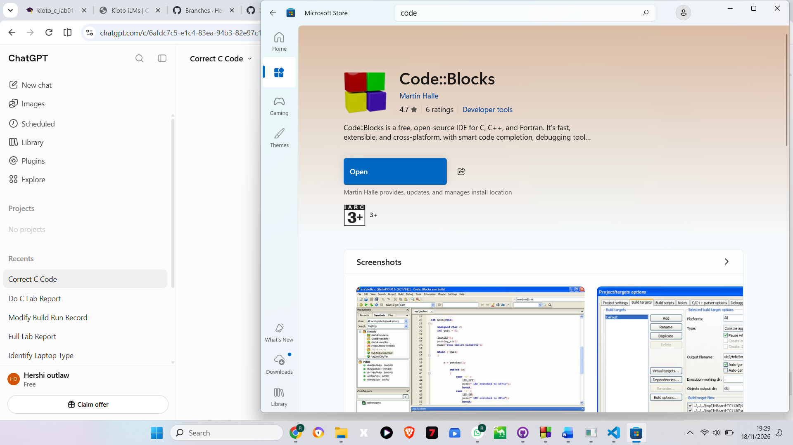

# ICS 2175 – Laboratory 01 Report

## 1. Cover Information

- **Student Full Name:** IRUNGU ROBIN GITAU
- **Registration Number:** ENB211-0139/2025
- **Programme:** AGRICULTURAL AND BIOSYSTEMS ENGINEERING
- **GitHub Username:** Hershi-23
- **Assigned Scenario:**
A campus printing desk estimates the cost of printed pages.

Variable Apages printed = 105
Variable Bcost per page = 3.5
Required calculationpages × cost per page
Output labelPrinting cost
Use these values and labels in Exercise 3. Your values may differ from those of other students.
- **Variant ID:** ENB211-0139/2025
- **Date:** 17/11/2026

## 2. Objectives
The objective of this laboratory exercise was to become familiar with the basic process of developing, compiling, running and submitting programs written in the C programming language. The practical also aimed to introduce the Windows programming environment, Code::Blocks integrated development environment (IDE), the GNU Compiler Collection (GCC), basic C program structure, variables, data types, formatted output and simple arithmetic operations. In addition, the exercise introduced version control and collaborative submission practices using Git and GitHub

## 3. Software and Hardware Environment

- **Operating System:**  (Windows 11)
- **IDE:** Code::Blocks (25.03)
- **Compiler:** GCC TODO (GNU GCC)
- **Hardware:** TODO (LENOVO X270, 8GB)

## 4. Code::Blocks Installation and Configuration

TODO: Describe how you installed and configured Code::Blocks and GCC. Include screenshots.
I OTAINED IT FROM MICROSOFT STORE 
## 5. Hello Kioto Implementation

TODO: Explain your Exercise 1 code. Include a code snippet and screenshot of the output.
#include <stdio.h>

int main(void)
{
printf("Hello, Kioto!\n");
printf("I am learning the C programming language.\n");
return 0;
}
.png>)

## 6. Explanation of C Program Structure

TODO: Explain `#include`, `main()`, statements, `return 0;` and braces.
#include <stdio.h>	Includes standard input/output declarations, including printf().
int main(void)	Defines the main function, where program execution begins.
{ }	Marks the beginning and end of the function body.
printf()	Displays formatted output on the console.
\n	Moves output to a new line.
return 0;	Ends the program and conventionally reports successful completion.
;	Terminates a C statement.
## 7. Variables and Data Types

TODO: Explain the variables you declared in Exercise 2 and the format specifiers used.
int	Whole numbers	int students = 45;
float	Decimal values with single precision	float temperature = 26.5f;
double	Decimal values with greater precision than float	double distance = 12.75;
char	A single character	char grade = 'A';

## 8. Personalised Calculation

TODO: Explain your assigned scenario, input values, operation and result. Include your variant ID. int main(void)
{
    int pagesPrinted = 105;
    float costPerPage = 3.5f;
    float printingCost = pagesPrinted * costPerPage;

    printf("Pages printed: %d\n", pagesPrinted);
    printf("Cost per page: KSh %.2f\n", costPerPage);
    printf("Printing cost: KSh %.2f\n", printingCost);

    return 0;
}
ENB/211/0139/2025

## 9. Testing and Troubleshooting

TODO: REMOVING THE SEMICOLON RUINS THE CODE
## 10. GitHub Workflow

TODO: Describe your fork, branch, commits and pull request (include screenshots/links).
Hershi-23/kioto-ics2175-c-lab01

## 11. Screenshots

TODO: Embed screenshots with captions.
-1.png>) .png>) .png>) .png>) .png>) .png>)

## 12. Individual Reflection

TODO: What did you learn? What was difficult? What will you do differently next time?
I LEARNT HOW TO USE THE C LANGUAGE IT WAS NOT DIFFICULT AM NOT CHANGING ANYTHING

## 13. Conclusion

TODO: Summarise the laboratory.
THE LABORATORE WAS OKAY